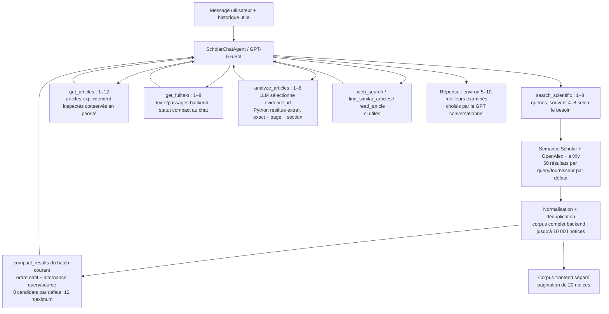

# EnnoScholar V2 — retour au chat agentique

La sélection scientifique appartient désormais au GPT conversationnel. Le chat normal ne lance plus `diverse_shortlist`, `rerank_candidates` ou des lots de qualification scientifique. `rank_scientific_articles` a été retiré du catalogue conversationnel. Aucun score issu de lots indépendants ne pilote les actifs, la pagination ou le fallback.

`scientific_selection.py` reste disponible pour compatibilité et tests isolés. Seul son regroupement d'identités publication/preprint, `work_groups`, est réutilisé dans le parcours normal : il ne note pas les articles et ne lance aucun appel LLM.

## Architecture exacte



Toutes les branches d'approfondissement sont facultatives. GPT peut chercher à nouveau, demander des détails, vérifier un texte, analyser ou répondre. Aucune étape de notation globale n'est imposée.

## Fonctions et comportement

- `ScientificSearch.search_batch` conserve la collecte multi-query et les échéances existantes. Tous les résultats complets sont enregistrés ; la sélection compacte respecte les positions natives des fournisseurs. Les groupes sont alternés par query, avec rotation du fournisseur prioritaire, puis parcours des positions suivantes. Aucun score lexical ou scientifique ne choisit les candidats compacts.
- `compact_results` et `compact_candidate` retournent au plus douze travaux dédupliqués : identifiant, titre, année, auteurs principaux, sources, DOI/arXiv, citations, queries, accès et abstract de 800 caractères maximum. Le nombre total backend n'est pas une preuve de pertinence.
- `ScholarChatAgent.execute_tool` enregistre tous les résultats, traduit les identifiants en identifiants stables de session et transmet uniquement les candidats compacts. Le batch `get_articles` reste un seul appel GPT pour 1–12 notices ; ses appels Python internes au lecteur unitaire ne sont pas des appels d'outils GPT supplémentaires.
- `ScholarChatAgent.register` préserve les notices, abstracts, URLs, analyses et fulltexts, et expose les associations publication/preprint sans suppression. Les URLs alternatives sont conservées. Les informations arXiv associées restent utilisables pour la récupération légale.
- `ScholarChatAgent.run` ne recalcule aucun top global. La génération principale, la compaction native, la suppression du préfixe ancien, les budgets, les réserves analyse/synthèse et la récupération après timeout restent en place.
- `ActiveSources.inspect/update/tool_result` donnent priorité aux articles demandés par `get_articles`, `get_fulltext` ou `analyze_articles`, puis aux candidats récents. La limite reste douze ; si plus de douze articles sont explicitement inspectés, le dernier batch explicite a priorité. Les notices détaillées sont raccourcies sous pression de tokens ; les extraits de preuve retenus restent exacts.
- `source_context` expose les notices actives, les statuts fulltext et les analyses compactes, sans texte intégral et sans anciens scores de ranking. Les abstracts complets et les analyses complètes restent backend.
- `analyze_article` utilise un catalogue de passages identifiés. Le schéma LLM n'autorise que `evidence_id` et `supports` pour les preuves. Python remet le texte exact, la page et la section depuis le catalogue ; les identifiants inconnus sont rejetés et les champs factuels sans preuve sont vidés. Les erreurs restent isolées article par article.
- `ScholarChatService.list_articles` conserve l'ordre du registre pour la pagination ; les anciennes notes LLM ne trient plus ce corpus.

## Validation simulée

**121 tests V2 réussis**, puis **32 tests ciblés réussis** après les dernières éditions. Un avertissement de dépréciation Starlette/AnyIO subsiste. **37 fichiers Python compilés**, `git diff --check` sans erreur.

La reproduction contrôlée, entièrement simulée, obtient :

```text
recherche large : 4 queries → 600 notices backend, 8 candidats compacts
GPT constate des candidats indirects et demande une recherche affinée
recherche affinée : 3 queries → registre cumulatif 642, 8 nouveaux candidats compacts
get_articles : 8 notices en un appel
get_fulltext : 3 articles en un appel
analyze_articles : 3 articles en un appel
réponse : 8 références de fixture, éditorial écarté
mémoire active : maximum 12
```

Cela représente **5 appels d'outils**, **6 appels conversationnels simulés**, **3 analyses LLM simulées**, et **0 appel de reranking automatique**. Le contexte conversationnel mesuré va de 5 403 à 13 684 tokens estimés. Les références et mots-clés benchmark sont exclusivement dans les tests ; le modèle conversationnel de cette reproduction est simulé. Ces résultats ne valident donc pas encore la pertinence du modèle réel.

Les tests couvrent aussi le corpus séparé du contexte, la diversité query/source, un faible score technique sans éviction, les pins à travers les recherches, les versions d'un même travail, les preuves exactes, les budgets, la compaction, le batch et les timeouts finaux avec réponse HTTP 200 partielle.

Les **135 empreintes de fichiers protégés sont inchangées**, notamment V1, EnnoDiagnostic, frontend, configuration, module fulltext et lecteur PDF/HTML. Aucun build frontend supplémentaire : aucun fichier frontend modifié pour cette intervention.

## Fichiers et sauvegardes

Sauvegarde avant édition : `D:\EnnoSmart\.ennosmart_patch_backups\scholar_v2_agentic_20261010_222014_004`. Les éditions successives ont également une copie horodatée dans `revision_*` avant écriture.

Fichiers applicatifs existants modifiés :

- `agents/EnnoScholarV2/agent.py`
- `agents/EnnoScholarV2/context.py`
- `agents/EnnoScholarV2/models.py`
- `agents/EnnoScholarV2/prompts.py`
- `agents/EnnoScholarV2/service.py`
- `agents/EnnoScholarV2/tools/scientific_search.py`
- `agents/EnnoScholarV2/tools/article_analysis.py`
- `agents/EnnoScholarV2/README.md`

Tests et fixtures existants adaptés :

- `tests/ennoscholar_v2/conftest.py`
- `tests/ennoscholar_v2/context_reproduction.py`
- `tests/ennoscholar_v2/orchestration_reproduction.py`
- `tests/ennoscholar_v2/report_scientific_behavior.py`
- `tests/ennoscholar_v2/scientific_fixture.py`
- `tests/ennoscholar_v2/test_article_access.py`
- `tests/ennoscholar_v2/test_batching.py`
- `tests/ennoscholar_v2/test_scientific_behavior.py`
- `tests/ennoscholar_v2/test_scientific_selection.py`

Nouveaux fichiers :

- `agents/EnnoScholarV2/tools/compact_results.py`
- `tests/ennoscholar_v2/test_agentic_flow.py`
- `agents/EnnoScholarV2/AGENTIC_REPORT.md`

Mesures détaillées locales : `.codex_tmp/scholar-v2-agentic-validation.json`, ignoré par Git.

Le modèle configuré reste `gpt-5.6-sol`. Aucun appel OpenAI réel, aucune collecte scientifique réelle, aucune intervention sur les processus backend/frontend et aucun déploiement OVH n'ont été effectués. Le benchmark réel reste à effectuer par l'utilisateur après son redémarrage local.
