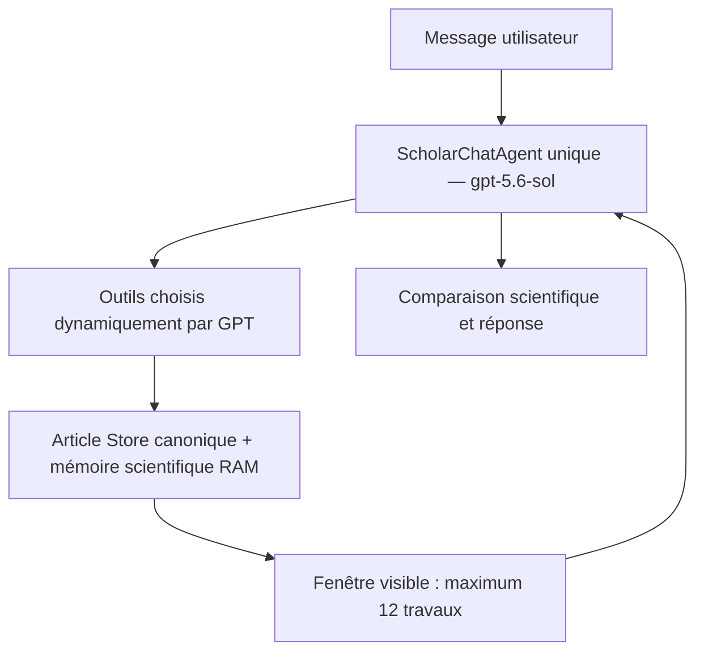

# EnnoScholar V2 — Canonicalisation et visibilité du corpus

Validation locale du 11 octobre 2026. Aucun appel réel OpenAI, Semantic Scholar,
OpenAlex ou arXiv. Aucun déploiement, redémarrage ou nouvelle dépendance.

## 1. Architecture après correction



La collecte reste large. `search_scientific` garde sa première fenêtre compacte
en ordre fournisseur. `search_collected_articles` donne accès au reste du corpus,
sans réseau. GPT choisit ses détails, fulltexts, analyses et finalistes. Aucun
reranker massif ni pipeline obligatoire n'a été ajouté.

## 2. Fichiers modifiés et ajoutés

Treize fichiers existants modifiés :

- `agents/EnnoScholarV2/agent.py` : outils locaux, enregistrement des versions,
  restauration/sauvegarde de la mémoire et clarifications.
- `agents/EnnoScholarV2/models.py` : mémoire, identifiants fournisseurs,
  notices d'origine, provenance des preuves et compteurs.
- `agents/EnnoScholarV2/context.py` : états distincts et fenêtre visible bornée.
- `agents/EnnoScholarV2/service.py` : mémoire RAM et API canonique paginée.
- `agents/EnnoScholarV2/article_reference.py` : résolution par travail/version.
- `agents/EnnoScholarV2/prompts.py` : navigation locale et choix des finalistes.
- `agents/EnnoScholarV2/tools/scientific_search.py` : identité/déduplication et
  conservation des IDs fournisseurs. Les requêtes, transports, concurrence,
  délais, pagination fournisseur et caches n'ont pas changé.
- `agents/EnnoScholarV2/tools/scientific_selection.py` : `work_groups` délègue
  uniquement l'identité à la couche commune. Son ancien ranking n'est pas ajouté
  aux outils ni réintroduit dans le parcours conversationnel.
- `agents/EnnoScholarV2/tools/compact_results.py` : vues canoniques, même ordre natif.
- `agents/EnnoScholarV2/tools/similarity.py` : recommandations uniques, versions
  conservées pour l'enregistrement backend, travail de référence exclu.
- `agents/EnnoScholarV2/tools/article_analysis.py` : provenance Python des preuves;
  notices fournisseurs complètes exclues de l'entrée LLM redondante.
- `tests/ennoscholar_v2/test_context_window.py` : un titre commun ne fusionne plus
  deux DOI/arXiv contradictoires.
- `tests/ennoscholar_v2/test_router.py` : contrat enrichi des trois compteurs.

Cinq nouveaux fichiers :

- `agents/EnnoScholarV2/canonical.py`
- `agents/EnnoScholarV2/evidence_provenance.py`
- `agents/EnnoScholarV2/tools/collected_search.py`
- `tests/ennoscholar_v2/test_canonical_visibility.py`
- `agents/EnnoScholarV2/CANONICAL_VISIBILITY_REPORT.md`

## 3. CanonicalWork

Projection RAM au-dessus des `Article` et `StoredArticle` existants, sans migration.
Chaque travail expose un `canonical_id`, une vue de métadonnées, les identifiants
connus et ses versions. `ArticleStore.payloads()` donne les records backend avec
leurs fulltexts, chunks et analyses; ces objets ne sont pas supprimés.

Les DOI, arXiv et IDs fournisseurs exacts, IDs de session et associations connues
sont regroupés transitivement par union-find. Les rapprochements par titre restent
conservateurs : auteurs compatibles, années distantes d'au plus deux ans quand
elles sont connues, pas de DOI de publication ni d'arXiv contradictoires. Le fuzzy
exige au moins huit mots, Jaccard >= 0,8, mêmes termes numériques et similarité de
caractères >= 0,94, ou 0,90 avec auteur commun. Un DOI arXiv et un DOI éditeur peuvent
identifier deux versions associables d'un travail.

Une publication est privilégiée comme vue représentative. Un canonique déjà connu
est réutilisé; en fusion de groupes, les autres IDs de versions restent des aliases.
Les notices d'une même version peuvent fusionner, avec leur contenu original dans
`provider_notices`. Les DOI distincts publication/preprint restent des versions
distinctes. Les DOI/URLs propres ne sont pas remplacés par les URLs associées.

## 4. search_collected_articles

Signature : `query`, `limit=10` borné à 1–12, `exclude_article_ids`, `cursor`.
Cherche uniquement les travaux déjà stockés. Le retour contient IDs de version et
canonique, titre, auteurs, année, DOI/arXiv, sources, accès, queries d'origine et
extrait d'abstract borné à 800 caractères. Les abstracts des autres versions et
notices restent recherchables, même si l'abstract principal est plus long.

Un travail n'apparaît qu'une fois. Exclure une version exclut le travail entier.
Le cursor poursuit les correspondances triées de la même query; il est invalidé
si query, exclusions ou contenu recherché changent. Une nouvelle query peut accéder
immédiatement à un candidat placé très loin dans l'ordre de collecte.

Le résultat contient `retrieval_only=true`. Les notices sont intégrées à la fenêtre
active, puis retirées de la sortie d'outil historique : le LLM reçoit les IDs et les
statuts, et voit les notices dans sa fenêtre bornée.

## 5. Méthode locale

BM25 par champ, bibliothèque standard uniquement : k1=1,2, b=0,75. Poids de navigation :
titre 3; abstract 1; auteurs 0,7; identifiants 2; queries d'origine 0,3.
Ces poids ne constituent pas un ranking scientifique. Aucun bonus de citations,
année, source ou accès; aucun `relevance_score` produit par cet outil. Les scores
locaux servent seulement à choisir la petite fenêtre et ne sont pas envoyés à GPT.
La diversité garantie est celle des travaux canoniques, sans variantes du même travail.

## 6. États distincts

- Corpus : tous les records et matériaux collectés, backend uniquement.
- `candidate_window` : dernière fenêtre proposée, maximum 12 travaux.
- `inspected_article_ids` : mémoire des consultations explicites.
- `pinned_article_ids` : notices à garder; l'inspection épingle aussi les notices.
- `finalist_article_ids` : finalistes choisis explicitement par GPT via
  `set_article_selection`, sans calcul de pertinence Python.
- `active_article_ids` : fenêtre effectivement visible, maximum 12 travaux uniques.

À l'arrivée d'une fenêtre, tous ses nouveaux travaux obtiennent une place visible;
les places restantes privilégient finalistes/pins. Avec 12 pins, des pins peuvent
être temporairement hors fenêtre, mais leurs listes, analyses et preuves restent
backend. `set_article_selection` remplace les deux listes choisies, au plus 12 chacune.

## 7. Persistance entre les tours

`ScholarSession.scientific_memory` conserve les états ci-dessus, les extraits locaux
et la clarification éventuelle. Le service copie l'état pour le tour et le commit
avec les résultats. Au tour suivant, finalistes puis pins sont restaurés avant les
actifs précédents et le fallback d'ordre du registre. Les derniers records ne sont
donc plus l'unique moyen de reconstruire la sélection.

RAM seulement : aucune table PostgreSQL; durée de session/configuration inchangée.

## 8. Resolver DOI

Priorité conservée : ID exact, DOI propre exact, arXiv propre, URL propre, URL associée,
titre, alias et fuzzy prudent. La multiplicité est évaluée en travaux canoniques.
Plusieurs versions d'un travail ne créent pas d'ambiguïté. Le DOI éditeur sélectionne
la publication correspondante; le DOI/arXiv de preprint sélectionne le preprint.
Les `work_urls` ne sont plus interprétés comme les DOI propres de chaque version.
La résolution des IDs de la première fenêtre respecte aussi les contradictions de DOI.

## 9. Clarification

Une ambiguïté conserve backend la liste numérotée des travaux, IDs et titres.
`le premier`, `le deuxième`, `2`, etc. utilisent exactement cet ordre au tour suivant.
La clarification est effacée après résolution. Un simple `celui-là` avec deux candidats
reste ambigu et redemande de préciser; il n'est pas utilisé pour deviner un choix.

## 10. Pages et provenance

Les `evidence_id`, catalogues de passages et validations restent identiques. Les
preuves ajoutent `source_article_id`, `canonical_work_id`, `source_version`, `source_url`.
`exact_quote` et `page_number` sont les aliases sérialisés de l'extrait exact et de la
page existants. Pour un abstract, `analysis_basis=abstract` et la version reste celle
de l'article; le matériau et la version ne sont pas confondus.

`analysis_material` fournit une copie annotée du fulltext, sans modifier le cache.
Une copie aplatie peut récupérer les chunks d'une version associée uniquement si
URL et texte vérifié correspondent, à espaces normalisés près. Les pages PDF
physiques 1-based et sections sont ainsi récupérées avec la provenance réelle du
preprint. HTML, abstract ou texte sans pagination fiable gardent `page_number=None`.
Le lecteur PDF et le fulltext resolver n'ont pas été modifiés.

## 11. Compteur et API

`articles_total`, le total de pagination et `canonical_work_count` comptent les
travaux. `record_count` compte les records backend; `version_count` compte les notices
de versions/origines conservées, avec au moins une par record. Ce dernier peut donc
inclure plusieurs notices fournisseurs d'une même version scientifique.

La pagination expose une vue par travail et les `related_article_ids`. Les records
originaux restent dans la session. Le frontend n'a pas changé; son compteur existant
utilise `articles_total`. Aucun écran supplémentaire de versions n'a été ajouté.

## 12. Validation globale

Commande exécutée dans l'environnement virtuel local :

```powershell
.\.venv\Scripts\python.exe -B -m pytest tests/ennoscholar_v2 -q -p no:cacheprovider --tb=short
```

**278 tests réussis en 90,12 s**, dont **42 nouveaux**. Un avertissement de dépréciation
Starlette/AnyIO déjà présent; aucune erreur. Les tests bloquent les appels OpenAI
réels et les connexions réseau externes. Compilation des sources en mémoire et
contrôles de whitespace réussis.

Reproduction contrôlée sans réseau : corpus de 1 100 records, cible position 961
(index 960), query scientifique ciblée, premier résultat local correct, cible visible
au chat, 12 actifs maximum et 12 pins/12 finalistes conservés. Sortie d'outil transmise :
382 octets / 91 tokens estimés; fenêtre visible : 5 883 octets / 1 646 tokens estimés.
Ces volumes proviennent de la fixture contrôlée, pas d'un nouveau run réel.

Contrôle SHA-256 de 681 fichiers source/configuration : seulement les 13 fichiers
existants listés ont changé. `.env`, modèle configuré `gpt-5.6-sol`, V1, EnnoDiagnostic,
EnnoAmel et frontend intacts. Les corps des fonctions de synthèse, retry, fallback,
comptage/compaction et I/O/cache scientifique restent identiques. Les fichiers
configuration, conversation, performance/cache, fulltext et lecteur PDF sont identiques.
Les limites d'analyse 3 500/6 000 et de synthèse 90/60 sont conservées.

## 13. Nouveaux tests

Le fichier `test_canonical_visibility.py` contient 42 cas exécutés, paramétrages inclus :
visibilité du candidat enfoui 900+, positions fournisseurs au-delà du premier,
queries/exclusions/cursors distincts, exclusion canonique, invalidation de cursor,
recherche par auteur/identifiant, abstracts plus courts des versions/notices,
pins/finalistes conservés, suivi de session, publication/preprint et IDs fournisseurs,
liaisons transitives, DOI propre et contradictions de titres, clarification ordinale,
preuves PDF/HTML/abstract, copie aplatie et vraie provenance preprint, texte réellement
non paginé, recommandations similaires uniques avec versions backend et compteurs API.

Les huit références historiques servent seulement aux fixtures : tests de visibilité
par titre et test de famille avec query scientifique générale. Un cas DOI publication/
preprint réel reproduit la fausse ambiguïté historique. Aucun nom ou DOI du benchmark
ne figure dans la logique de production ajoutée.

## 14. Backups

Racine :
`D:\EnnoSmart\.ennosmart_patch_backups\scholar_v2_canonical_visibility_20261011_134955_847185`

Copies originales, manifeste des chemins et snapshot des hashes; sous-dossiers
`revision_YYYYMMDD_HHMMSS_microsecondes` avant chaque nouvelle modification d'un fichier
existant, y compris les retouches des nouveaux fichiers et la restauration des fins
de ligne originales. Aucun backup restauré aveuglément.

## 15. Limites restantes

- Retrieval lexical : pas d'équivalence sémantique automatique entre synonymes ou
  langues. GPT peut reformuler ses queries locales, sans nouvelle dépendance.
- Identité sans identifiant fort : titres/auteurs/années incomplets restent un risque
  de rapprochement manqué ou erroné malgré les garde-fous conservateurs.
- La recherche locale reconstruit ses vues/index légers à chaque appel; le coût dépend
  du volume de textes et des groupes de titres semblables. Pas de moteur/cache lourd.
- Le fonctionnement scientifique de GPT et son choix des nouveaux outils n'ont pas
  été mesurés par un nouvel appel réel, conformément à la demande.
- Mémoire volatile au redémarrage. Versions détaillées accessibles backend, sans
  nouvelle interface dédiée. Pagination inconnue reste inconnue.

Le travail s'arrête ici, sans déploiement ni redémarrage.
