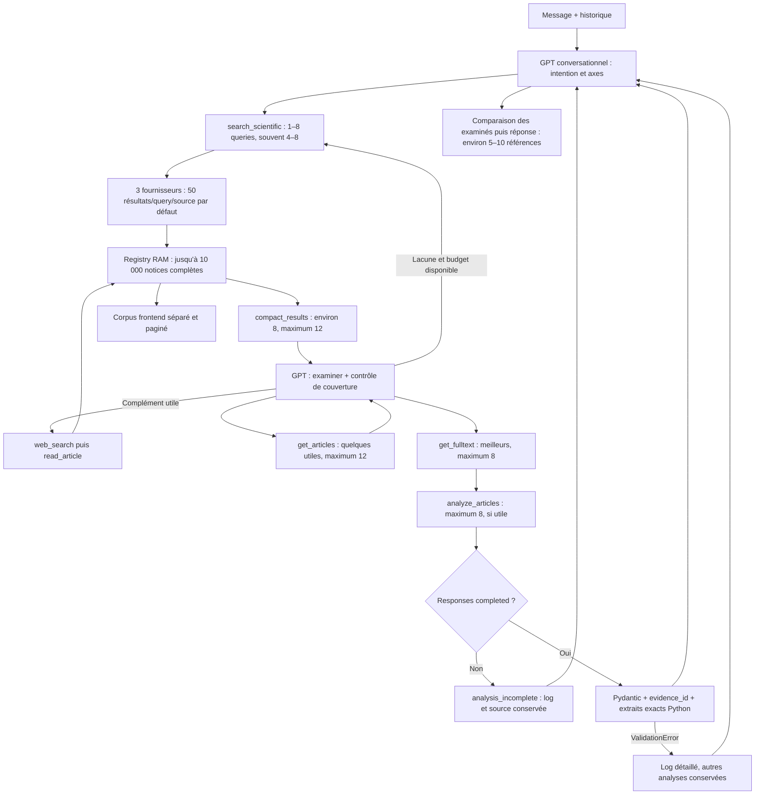

# EnnoScholar V2 — recherche itérative et diagnostic d'analyse

La recherche reste agentique. Le prompt conversationnel demande désormais explicitement un contrôle de couverture après chaque recherche : vérifier les opérations réellement traitées, identifier les familles absentes, lire quelques abstracts si nécessaire et affiner les queries avec les termes découverts. Le Web est un complément facultatif ; un article découvert sur le Web doit être enregistré via `read_article` avant approfondissement. Aucun nombre obligatoire de recherches ni nouveau moteur de ranking n'a été ajouté.

La comparaison finale porte sur le petit ensemble examiné. Adéquation à la tâche, méthode, contexte et contribution priment sur citations, année, accès ou présence d'un PDF. Les distinctions DIRECT/FONDAMENTAL/CONNEXE restent un jugement du GPT conversationnel. Aucun titre, DOI, auteur ou vocabulaire du benchmark n'a été ajouté au code de production.

Le statut documentaire distingue la récupération de texte de son analyse. `fulltext` signifie texte récupéré ; une analyse disponible indique séparément les passages effectivement analysés. Une erreur d'analyse ne transforme pas un PDF téléchargé en texte analysé.

## Fichiers existants modifiés

Fichiers applicatifs :

- `agents/EnnoScholarV2/prompts.py` : consignes conversationnelles.
- `agents/EnnoScholarV2/tools/article_analysis.py` : contrôle du statut Responses et logs structurés.
- `agents/EnnoScholarV2/agent.py` : identification de chaque erreur du batch et retour explicite `analysis_incomplete`.

Mocks d'analyse mis à jour uniquement pour annoncer `status="completed"`, conformément au contrat Responses :

- `tests/ennoscholar_v2/test_agentic_flow.py`
- `tests/ennoscholar_v2/test_article_access.py`
- `tests/ennoscholar_v2/test_batching.py`
- `tests/ennoscholar_v2/scientific_fixture.py`
- `tests/ennoscholar_v2/context_reproduction.py`
- `tests/ennoscholar_v2/orchestration_reproduction.py`
- `tests/ennoscholar_v2/report_scientific_behavior.py`

Nouveaux fichiers :

- `tests/ennoscholar_v2/test_analysis_diagnostics.py`
- `tests/ennoscholar_v2/test_iterative_research.py`
- `agents/EnnoScholarV2/ITERATIVE_DIAGNOSTICS_REPORT.md`

## Fonctions concernées

- `SYSTEM_PROMPT` : compréhension générale, queries complémentaires, coverage check, recherche en entonnoir, complément Web, jugement scientifique et accès documentaire.
- `analyze_article` : après l'appel Responses existant, exige `status == "completed"` avant validation. Sinon log des métadonnées et exception `AnalysisIncompleteError`. Les `ValidationError` sont journalisées avec `errors(include_input=False)` puis remontées au traitement individuel du batch.
- `response_diagnostics` (nouvelle) : article_id, titre, base, nombre de chunks, caractères de leur texte, response_id, statut, incomplete_details, tokens d'entrée/sortie et longueur du texte de sortie. `material_char_count` est la somme des caractères des chunks utilisés, pas la taille du fichier PDF ou du JSON complet.
- `ScholarChatAgent.execute_tool`, bloc d'erreur de `process` uniquement : log article_id/titre/base/type/raison. L'erreur d'un article n'interrompt pas les autres. Le retour incomplet conserve `access_level` et ajoute un message `analysis_incomplete` ; les notices et PDF restent backend.

Le schéma `AnalysisDraft`, `EvidenceReference`, `strict_schema`, le catalogue des preuves et l'appel OpenAI d'analyse (prompt, payload, `store=False`, limite 3500) sont identiques à la sauvegarde. Aucun retry d'analyse ajouté. Les identifiants de preuve inconnus restent ignorés et les conclusions non étayées supprimées.

## Backups

Avant les modifications :

`D:\EnnoSmart\.ennosmart_patch_backups\scholar_v2_iterative_diagnostics_20261011_030545_687174`

Dix fichiers sauvegardés. Les rééditions ont également une copie préalable dans `revision_20261011_030930_805878` et `revision_20261011_031052_293737`. `baseline.json` contient les empreintes initiales de 770 fichiers ; `modified_paths.json` précise les dix fichiers existants autorisés.

## Validation

**137 tests V2 réussis**, dont **16 nouveaux cas de test**. La suite couvre les budgets soft/hard et réserves, la compaction native, le batch de notices/fulltext/analyses, les preuves exactes, le fallback HTTP 200 et la pagination. Un avertissement de dépréciation Starlette/AnyIO subsiste.

Nouveaux cas : six statuts non terminés, JSON tronqué, type invalide, champ obligatoire absent, valeur enum invalide, logs bornés sans texte complet, preuve inconnue, deux échecs dans un batch avec analyse réussie et HTTP 200, recherche itérative dans deux domaines et absence de titres du benchmark dans le prompt de production.

La reproduction contrôlée dans les deux domaines vérifie :

- Première collecte : quatre queries × trois fournisseurs simulés × 50 notices = 600 articles uniques, huit candidats compacts.
- Examen d'une notice connexe, avec découverte d'un terme scientifique réutilisé dans la query suivante.
- Deuxième collecte ciblée : un nouvel article direct et une notice déjà connue = 601 articles backend.
- Complément Web et `read_article` par DOI : un nouvel article = 602 articles backend.
- Deux `get_articles` au total, un `get_fulltext` et un `analyze_articles`.
- Dix articles actifs, maximum douze dans chaque requête ; les articles examinés restent présents.
- Le candidat direct sans PDF et avec peu de citations reste examinable et précède le candidat connexe OA dans la réponse simulée.
- Huit appels conversationnels simulés et une analyse simulée ; aucun appel de ranking.
- Contexte : 5 258–8 375 tokens estimés pour le premier domaine ; 5 253–8 373 pour le second.

Les réponses et choix scientifiques de ces tests sont simulés : ils valident les échanges et invariants techniques, pas la qualité d'un modèle réel. Le benchmark réel reste à refaire après le redémarrage par l'utilisateur.

La reproduction des erreurs utilise les deux identifiants benchmark avec des causes **artificielles** : réponse incomplète pour le premier, type invalide pour le second, troisième analyse réussie. Elle n'établit pas la cause des anciennes erreurs réelles.

Mesures et logs simulés complets :

`D:\EnnoSmart\.codex_tmp\scholar-v2-iterative-diagnostics-20261011_031127_007929.json`

Vérification des fichiers : 760 fichiers de la baseline inchangés, dix modifications attendues, aucune modification inattendue. `ScholarChatAgent.run` est inchangé par comparaison AST. Les fournisseurs, `search_scientific`, `compact_results`, ActiveSources, le context management, le resolver fulltext, les schémas, configuration/modèle, frontend, V1 et EnnoDiagnostic sont inchangés. Syntaxe de 38 fichiers Python vérifiée.

## Parcours final



Les branches et approfondissements sont choisis par GPT ; le diagramme ne crée aucun pipeline obligatoire. La mémoire active conserve au plus douze notices et privilégie les choix explicites déjà approfondis.

## Exemples des nouveaux logs

Extraits raccourcis de la reproduction **simulée** ; les titres et autres métadonnées complets sont dans le JSON local :

```text
EnnoScholar V2 analysis_incomplete {"article_id":"art_942bde322abe27ebd8ff","analysis_basis":"fulltext","chunk_count":1,"material_char_count":57,"response_status":"incomplete","incomplete_details":{"reason":"max_output_tokens"},"input_tokens":4200,"output_tokens":3500,"output_text_length":10,...}
EnnoScholar V2 batch article failure tool=analyze_articles article_id=art_942bde322abe27ebd8ff title="DL-Polycube: ..." basis=fulltext error_type=AnalysisIncompleteError reason=analysis_incomplete

EnnoScholar V2 analysis_validation_error {"article_id":"art_7343e4f0cf5a62497734","analysis_basis":"fulltext","response_status":"completed","incomplete_details":null,"input_tokens":4200,"output_tokens":3500,"output_text_length":68,"error_type":"ValidationError","validation_errors":[{"type":"string_type","loc":["method"],"msg":"Input should be a valid string",...}],...}
EnnoScholar V2 batch article failure tool=analyze_articles article_id=art_7343e4f0cf5a62497734 title="DDPM-Polycube: ..." basis=fulltext error_type=ValidationError reason=analysis_validation_error
```

Seuls les erreurs de validation d'une réponse terminée ajoutent des extraits de sortie : au plus 400 caractères de début et 400 de fin, avec une portion centrale toujours omise même pour une courte réponse. Aucun fulltext, passage source complet ou sortie LLM complète n'est journalisé par ces nouveaux diagnostics.

Le contrôle `status`/`incomplete_details` suit la [documentation officielle OpenAI Responses](https://developers.openai.com/api/reference/python/resources/responses/methods/create).

Aucun appel OpenAI réel, aucune recherche fournisseur réelle, aucun redémarrage backend/frontend ni déploiement n'a été effectué. Les processus existants n'ont pas été pilotés. Le modèle et son endpoint sont conservés. Le prochain run réel permettra enfin d'identifier précisément les éventuelles erreurs d'analyse.
