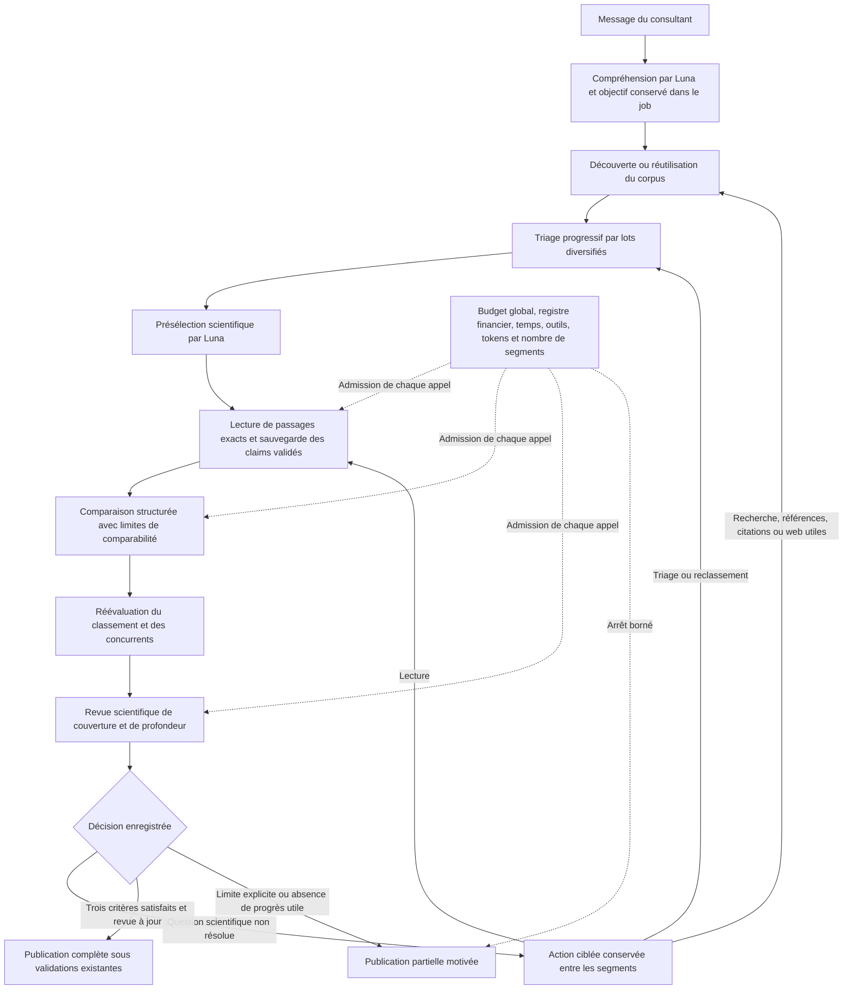

# EnnoScholar V4 — Correction de la politique décisionnelle

Date : 22 octobre 2026. Worktree : `C:/Users/hp/.codex/worktrees/ennoscholar-v4/EnnoSmart`.
Branche conservée : `feature/ennoscholar-v4-diagnostic-link`.

## 1. Décision architecturale

La correction centrale est une politique explicite dans `research.py`, exécutée par l'agent existant. Aucun nouvel agent, service, moteur de recherche ou modèle n'est ajouté.

Atteindre le nombre demandé ne signifie plus que la recherche est complète. Le classement scientifique et la qualité documentaire sont séparés. Une première lecture fournit un checkpoint pour une revue sémantique, sans suffire à certifier la profondeur.



Les décisions scientifiques restent celles de Luna. Le code contrôle l'actualité des données, l'exécution des décisions, les prérequis, la provenance et les limites d'exécution.

## 2. Fichiers et fonctions modifiés par cette mission

Les modifications non commitées antérieures ont été conservées. Le tableau décrit les ajouts de cette mission, pas l'ensemble du diff historique du worktree.

| Fichier | Fonctions ou contrats | Effet |
|---|---|---|
| `agents/EnnoScholarV4/research.py` | `ResearchReviewArgs`, `ArticleDepthReview`, `DimensionReview`, `ResearchAction` | Revue typée : profondeur, justification du classement, lacunes, actions et arrêt explicite. |
| Même fichier | `canonical_selection`, `status`, `needs_discovery` | Séparation du compteur, de la profondeur et de la justification ; maintien de l'ordre scientifique entre travaux distincts. Une version mieux documentée peut représenter le même travail vérifié, sans promouvoir un autre travail pour son PDF. |
| Même fichier | `transition`, `triage_pool`, `record_ranking`, `ranking_current`, `comparison_current`, `depth_status` | Transitions testables, concurrents non évalués conservés, classements révisés sur le même dossier, reçus de comparaison et de profondeur invalidés lorsque leurs données changent. |
| Même fichier | `save_review`, `progress_signature`, `job_evaluate` | Exécution des questions restantes, actions durables, distinction entre progrès scientifique et simple compteur de fiches, arrêt partiel propagé au job. |
| Même fichier | `source_plan`, `exploration_options` | Pages partielles reprenables, pagination suivie par fournisseur même si la liste de fournisseurs change. |
| `agents/EnnoScholarV4/agent.py` | `ScholarChatAgent.run`, notamment `selection_pool`, `argumentation_stage_allowed`, `request_inputs`, `finalize` | Exécution réelle de la boucle ; comparaison bibliographique indépendante de l'existence d'un blueprint ; revue obligatoire avant une synthèse volontaire ; actions ciblées et reprise ; contexte adapté aux lots et à la revue. |
| `agents/EnnoScholarV4/toolkit.py` | `CompareArgs`, `ScholarTools.search`, `prefetch_searches`, branches `compare_articles` et `record_candidate_decisions` | Comparaison structurée traçable même sans supériorité démontrable ; historique de classement par fenêtres ; décisions du consultant prioritaires ; notices reçues mais non insérées conservées pour reprise locale. |
| `agents/EnnoScholarV4/scientific_reading.py` | `refresh_task`, `reading_tasks`, `next_task`, `prepare_reading`, `completed`, `reading_context`, `comparison_ready` | Checkpoint initial distinct de la profondeur validée ; lecture guidée par une question explicite sur des passages frais ; conservation des états documentaires et des limites. Le comportement de rédaction est conservé hors recherche bibliographique. |
| `agents/EnnoScholarV4/context.py` | `model_context` | Abstracts complets dans les fenêtres effectivement transmises, claims accessibles pour le reclassement, concurrents visibles dans la revue, absence de duplication des dossiers de profondeur. Les enregistrements durables ne sont pas raccourcis. |
| `agents/EnnoScholarV4/publication.py` | `publish` | Refus d'une publication déclarée scientifiquement suffisante sans revue actuelle satisfaisant les conditions. Les résultats partiels restent publiables. |
| `agents/EnnoScholarV4/tools/tables.py` | `html_table` | Expansion littérale des cellules fusionnées, en-têtes hiérarchiques et origine des cellules ; maintien du statut ambigu lorsque l'association n'est pas fiable. |

`ArticleStore`, `ArticleAnalyzer.save`, les validateurs de preuves, les fiches cumulatives, la mémoire, le driver de jobs, le registre financier, la politique Luna et le cache existants sont réutilisés. Il n'y a pas de nouveau score Python de pertinence scientifique.

## 3. Contrats et conditions de passage

### Complétude

Une recherche complète exige simultanément :

1. `target_reached` : le nombre demandé de travaux distincts du classement est atteint par des fiches vérifiées avec leurs propres preuves ; un candidat prioritaire encore non analysé ne disparaît pas derrière un article plus facile à lire.
2. `analysis_sufficient` : décision de revue actuelle. Pour une recherche profonde, chaque finaliste possède une revue de profondeur actuelle et suffisante.
3. `scientific_selection_justified` : justification scientifique actuelle, comparaison sauvegardée couvrant les finalistes, classement réévalué sur les fiches actuelles et les concurrents non rejetés.
4. Revue globale `sufficient=true`, sans lacune déclarée ni action encore en attente.

Les fenêtres de reclassement s'accumulent sur une signature scientifique commune. Réviser les premiers candidats d'un lot ne certifie pas les concurrents omis par la limite du contexte.

### Profondeur

Une revue d'article distingue les méthodes, protocoles, résultats, comparaisons, limites et, lorsque c'est pertinent, la théorie. Son type est expérimental, théorique, mixte ou inconnu.

Les états d'une dimension sont `verified`, `absent`, `unavailable`, `unread`, `ambiguous`, `not_applicable`. Les preuves doivent appartenir à l'article, avoir été présentées et correspondre exactement à un snapshot conservé. Un passage lu sans claim peut justifier une revue, sans fabriquer une affirmation de résultat.

Une absence dans les seuls passages examinés n'établit pas une absence dans l'article. Une absence globale exige soit une déclaration explicite des auteurs citée, soit un texte disponible parcouru sans troncature. La portée est sauvegardée dans `scope`. La validité sémantique d'une interprétation reste une responsabilité du modèle et doit être contrôlée sur le test réel.

Une dimension déclarée non lue ou ambiguë peut produire directement une action de lecture sur les passages encore accessibles, même si le modèle omet le tableau redondant des actions. Le code n'invente pas une lacune à partir du seul fait qu'un champ est vide.

Il n'existe pas de nombre obligatoire total de passages par publication. Les fenêtres bornent le contexte ; les questions scientifiques, la progression réelle, l'accès et le budget déterminent la poursuite.

### Actions et limites

Les actions enregistrent type, cibles, question/requête, famille, fournisseurs, page, justification, signature de départ, état et résultat. Elles réutilisent `analyze_article`, `get_article`, `search_scientific`, `find_similar_articles` et la recherche web native.

Le web est choisi pour une lacune explicite, puis ses découvertes doivent être vérifiées. Ni le web ni les références/citations ne sont imposés à toute recherche.

Une action inchangée sur un dossier inchangé n'est pas relancée. Les lectures peuvent poursuivre la même question si elles ont réellement avancé sur de nouveaux passages ; leur profondeur totale n'est pas plafonnée à deux fenêtres. Les garde-fous globaux restent applicables.

Un arrêt par temps, tokens, outils, coût, nombre de segments, accès ou absence de progrès reste partiel et motivé. Le message de continuation automatique n'est plus affiché lorsqu'une revue a explicitement décidé l'arrêt partiel du job.

## 4. Tests et traces rejouées

Tests ajoutés dans `tests/ennoscholar_v4/test_decision_policy.py`. Tests existants adaptés dans `test_research_completion.py`, `test_run_53292dc4.py`, `test_context_memory.py` et `test_document_orchestration.py`.

Les anciens tests qui validaient « compteur atteint = recherche complète » ont été corrigés pour distinguer les trois dimensions. Le test d'interruption de rédaction vérifie les identifiants réellement sauvegardés, plutôt que de supposer l'ordre de fin de tâches concurrentes.

Les scénarios couvrent notamment :

- cinq abstracts sans réussite profonde automatique ;
- succès profond après revue explicite, puis invalidation par un changement de fiche ;
- candidat tardif, classement indépendant du PDF, décision explicite du consultant ;
- reclassement après lecture et suivi des concurrents omis d'une fenêtre ;
- comparaison et revue effectivement appelées pour `literature_search`, même avec un ancien blueprint valide ;
- deux vagues : cinq travaux provisoires, découverte de concurrents plus directs, lecture de leurs textes déjà fournis au scénario, remplacement de finalistes, justification conservée, arrêt partiel explicite ;
- questions non lues traduites en actions de lecture, reprise sur des passages frais ;
- preuve d'un autre article refusée, absence locale non transformée en absence globale ;
- triage progressif de 55 notices, mise en attente réexaminable ;
- page partiellement collectée reprise après reconstruction de l'outil, sans deuxième appel fournisseur ;
- budget global de 1 dollar conservé sur plusieurs segments, progression des actions prise en compte ;
- boucles refusées sur une action inchangée ;
- tableaux multi-en-têtes et cellules fusionnées fiables ou explicitement ambigus ;
- politique exclusive Luna et suites existantes de rédaction, interruption, reprise et comptabilisation.

Relectures d'archives, uniquement via SQLite `mode=ro` et copies mémoire :

| Archive | Vérification |
|---|---|
| Run `94599ea8d32040f986ba9c771f045837` | Le compteur historique et les dix recommandations ne certifient pas la qualité ; réutilisation des fiches et conservation de leurs anciens claims/preuves pendant une continuation simulée. |
| Session `53292dc472204046a0b48eb5b3408d11` | Conservation des résultats chiffrés et preuves dans le dossier final ; sélection unique respectant désormais l'ordre scientifique ; publication partielle de fiches existantes après un arrêt documentaire explicite. |
| Run `bfc10a57e8f940728fe535037f586146` | Cinq fiches ne suffisent pas ; notices non évaluées visibles ; DL-Polycube reste insuffisamment revu et une question ciblée propose des passages nouveaux du texte déjà stocké, sans téléchargement ni appel LLM. |

Commande de référence :

```powershell
$env:PYTHONDONTWRITEBYTECODE='1'
& 'D:\EnnoSmart\.venv\Scripts\python.exe' -B -m pytest tests/ennoscholar_v4 -q -p no:cacheprovider --tb=short --disable-warnings
```

Résultat du passage final sur le code terminé : **745 tests réussis, aucun échec, en 404,31 secondes**. Les 21 scénarios du nouveau fichier de tests sont inclus. Les 9 805 avertissements concernent principalement les usages existants de `datetime.utcnow()` dans le stockage et les jobs ; ils ne constituent pas des échecs de tests. Un passage complet intermédiaire avait également réussi avec 742 tests avant les derniers ajouts de régression.

`git diff --check` n'a signalé aucune erreur de whitespace. Git signale seulement les conversions LF/CRLF habituelles du worktree Windows.

Les sockets externes et les appels OpenAI réels sont bloqués par les fixtures. Les bases créées par les tests sont temporaires ou en mémoire. Les archives réelles sont uniquement lues.

## 5. Coût et composants préservés

- Aucun appel LLM payant pendant les travaux.
- `gpt-6-luna` reste imposé par la politique existante, y compris pour les nouvelles étapes.
- Aucun changement de catalogue, clé, cache, plafond du job, limite de segments ou configuration du backend.
- Le scénario de budget vérifie explicitement un plafond global de 1 dollar ; les réservations et coûts incertains restent comptés par les mécanismes existants.
- Les étapes de triage, comparaison, reclassement et revue peuvent ajouter des appels utiles et des tokens. Le coût réel de cette meilleure couverture n'est pas mesuré par une simulation ; il doit être observé sur le prochain test contrôlé.
- La reprise locale des notices déjà récupérées, la réutilisation des comparaisons actuelles et le refus des actions répétées évitent des appels inutiles.

## 6. Limites et prochain test réel

Les tests prouvent des transitions et des garanties techniques. Ils ne prouvent ni que Luna choisira les meilleurs travaux réels, ni que toute appréciation scientifique sera correcte.

Les anciennes notices déjà perdues avant cette correction ne sont pas recréées depuis un simple compteur. Les nouvelles réponses fournisseurs sont conservées pour la reprise ; une ancienne page réellement amputée peut nécessiter une nouvelle requête bibliographique lors d'un futur test autorisé.

Le nouveau parseur de tableaux s'applique aux extractions futures. Aucune preuve ni aucun tableau déjà sauvegardé n'a été réécrit. Les anciens tableaux ambigus restent ambigus ; aucune conversion silencieuse ne les déclare fiables.

Le backend actif et les workers n'ont pas été redémarrés. Ce travail ne constitue pas une validation du code effectivement chargé sur OVH. Avant un test réel, vérifier la version chargée dans les processus autorisés, le modèle Luna, le plafond effectif de 1 dollar et le worker/exécuteur configuré.

Pendant ce test, contrôler :

1. Les traces `research_transition`, les outils de comparaison/revue et leurs reçus sauvegardés.
2. La place réellement donnée aux nouveaux concurrents et aux décisions du consultant.
3. Les preuves des principaux résultats, conditions expérimentales et limites, ainsi que la portée réelle des déclarations d'absence.
4. Les actions encore en attente après un segment, puis leur reprise avec le même budget.
5. Les tokens, lectures effectives de cache, coûts confirmés/réservés/incertains et motifs d'arrêt.
6. La conservation des onze brouillons et des fiches antérieures.

## 7. Intégrité et périmètre

Aucun changement de base réelle, dossier client, manuscrit réel, configuration active, EnnoDiagnostic, EnnoAmel ou EnnoValor. Aucun téléchargement scientifique supplémentaire, redémarrage, commit, push, reset ou changement de branche effectué.

La base d'archives `ennoscholar_v4_test.db` conserve une date de dernière écriture du 21 octobre 2026 à 17:35:08 UTC lors du contrôle ; les nouvelles lectures de tests ne l'ont pas réécrite.
