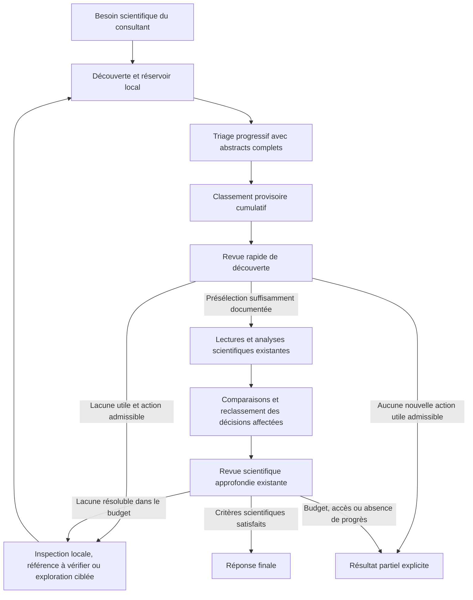

# EnnoScholar V4 — correction de la découverte et du classement

Date : 22 octobre 2026. Périmètre : V4 exclusivement.

## Ce qui change

Le classement devient cumulatif : un nouveau lot ne remplace plus la liste des finalistes. L'absence d'un article dans une réponse de Luna ne le retire pas du top. Une proposition de remplacement doit désigner l'entrant, le sortant, une justification comparative, les informations utilisées et les incertitudes. Les dossiers reçus doivent correspondre aux versions scientifiques et au besoin actuels. Les décisions explicites du consultant restent prioritaires.

Les composants existants sont réutilisés : corpus et réservoir persistants, file d'actions, lectures et preuves, contrôles scientifiques, jobs segmentés, registre financier, cache et politique de modèle. Aucun moteur de lecture ou validateur scientifique n'est remplacé.



Le passage par la revue rapide n'atteste ni une lecture approfondie ni une recherche exhaustive. Les conditions existantes de complétude scientifique restent nécessaires à la finalisation.

## Fichiers et fonctions modifiés par cette intervention

Les fichiers étaient déjà partiellement modifiés avant cette intervention. Cette liste désigne les ajouts de la présente correction ; elle ne revendique pas l'ensemble du diff Git existant.

| Fichier | Fonctions ou interfaces concernées | Effet |
|---|---|---|
| `agents/EnnoScholarV4/research.py` | `RelevanceProfile`, `RankingReplacement`, `DiscoveryReviewArgs`, `candidate_signature`, `need_signature`, `record_ranking`, `ranking_current`, `stale_ranking_candidates`, `cumulative_ranking`, `triage_pool`, `selection_ids`, `transition` | Contrats de comparaison, top cumulatif, évaluations versionnées et transitions explicites. |
| Même fichier | `discovery_packet`, `save_discovery_review`, `enqueue_actions`, `collect_reference_leads`, `reference_inventory_signature`, `local_page`, `source_plan`, `exploration_options`, `status`, `job_evaluate` | Revue avant lecture, actions ciblées persistantes, bibliographie traçable, reprise locale de pages et arrêt partiel honnête. |
| `agents/EnnoScholarV4/toolkit.py` | `DecisionsArgs`, `Decision`, `ScholarTools.delivered`, traitement de `record_candidate_decisions` et `review_discovery` dans `execute`, `search`, `prefetch_searches`, traitement de `get_article` | Application contrôlée du classement, reçus des dossiers transmis, réutilisation des décisions et des résultats déjà stockés. |
| `agents/EnnoScholarV4/context.py` | `scientific_dossier`, `fit_selection`, `fit_focused`, `model_context`, `SelectionContextError` | Même représentation scientifique pour finalistes et concurrents ; place réservée aux finalistes ; report de concurrents entiers si le contexte ne tient pas. |
| `agents/EnnoScholarV4/agent.py` | `ScholarChatAgent.run` : `selection_pool`, transitions de recherche, exécution des actions, construction et consignes du contexte de sélection | Branchement de la revue rapide, évaluations ciblées et inspection locale. Les actions de lecture utilisent le plafond existant de lectures par segment. |
| `agents/EnnoScholarV4/sources.py` | `V4ScientificSearch._get_paced`, `ScientificSources.search` | Enregistrement des paramètres effectivement envoyés après traduction et pagination, par fournisseur et tentative, sans en-têtes ni paramètres d'authentification. |
| `agents/EnnoScholarV4/store.py` | `interleave_by_provider`, `ArticleStore.resolve`, `ArticleStore.insert` | Ordre stable entre fournisseurs, résolution locale exacte, enrichissement prudent d'un abstract et conservation des identités distinctes. |

Tests ajoutés : `tests/ennoscholar_v4/test_discovery_ranking.py`. Tests existants adaptés à la revue rapide : `test_decision_policy.py` et `test_research_completion.py` dans le même répertoire.

## Règles scientifiques et persistance

### Entrer, rester ou sortir du classement

- Un candidat doit être connu, effectivement présenté, retenu et compatible avec les décisions du consultant. Un candidat privé d'informations nécessaires reste provisoire. Une place vacante peut être remplie par un candidat retenu.
- À classement plein, entrer exige un remplacement explicite recevable. Une comparaison sans dossiers actuels est ignorée et sa proposition est conservée pour réexamen.
- Un finaliste demeure en place par défaut, même si les lots suivants ne le mentionnent pas. Une décision de rejet ne permet pas de contourner le contrat de retrait explicite.
- Une préférence, un retrait ou une mise en attente explicite du consultant prime. Les versions vérifiées du même travail occupent une seule place ; leurs identifiants de preuves et leurs sources restent distincts.
- L'historique du remplacement conserve les dépendances, la provenance et les empreintes des dossiers. De nouvelles informations peuvent invalider les décisions concernées sans invalider tout le corpus.

### Critères confiés à Luna

Le profil de pertinence porte sur le problème, la sortie produite, la méthode, l'objet et son échelle, le rôle de l'IA, les conditions d'application, les résultats et validations, l'adéquation au besoin et les inconnues. Ces critères se déclinent à partir du besoin ; aucune taxonomie de maillage 3D n'est codée dans les décisions scientifiques.

Le code contrôle les identités, les informations effectivement transmises, les versions, la cohérence du classement et les budgets. Luna reste responsable du jugement comparatif scientifique. Une justification textuelle structurée ne constitue pas une preuve que le jugement est correct.

### Contexte et triage

Les anciens finalistes et les nouveaux concurrents reçoivent le même schéma de dossier : abstract, profil, affirmations sauvegardées bornées, provenance et profondeur connue. L'abstract complet est envoyé une seule fois dans le paquet de sélection. Un dossier réduit identifie ses omissions ; il ne transforme pas un manque de contexte en absence scientifique.

Les finalistes disposent de places protégées. Sous contrainte de contexte, les concurrents sont différés entiers et restent disponibles au prochain lot. Si une comparaison équitable ne tient pas, l'exécution s'arrête explicitement avec `context_budget` au lieu de juger sur des titres seuls.

La réception d'un abstract et son évaluation sont distinctes. Une interruption entre ces étapes ne marque pas le candidat comme traité. TetGAN et NVMG peuvent donc être représentés avec leurs abstracts complets déjà stockés. Une information inchangée déjà évaluée ne provoque pas de boucle de triage.

### Reclassement ciblé

Chaque évaluation dépend du besoin et des informations scientifiques du candidat, éventuellement de son concurrent dans une comparaison explicite. Une lecture nouvelle invalide ces dépendances ; les évaluations non affectées restent valides. Un simple téléchargement de texte non encore analysé ne déclenche pas un nouveau jugement de pertinence.

Les empreintes utilisées par les contrôles scientifiques approfondis restent conservées. La nouvelle signature de classement distingue ce contrôle de pertinence des preuves de lecture et de validation.

## Exploration complémentaire

La revue rapide examine familles, finalistes, concurrents retenus, candidats en attente, réservoir et références à vérifier. Elle propose au plus trois actions motivées. Elle ne peut pas programmer une lecture approfondie. Les actions réutilisent la file durable et ses protections contre la répétition.

Les notices et pages stockées sont prioritaires. La reprise d'une page partielle, y compris pour un sous-ensemble des fournisseurs, consomme ses résultats locaux sans rappeler les API. Les limites d'exploration existantes restent appliquées après reprise ; une action locale ne consomme pas une nouvelle admission réseau.

Selon la lacune, les opérations existantes restent disponibles : inspection d'un DOI ou d'une notice, pagination, requête ciblée, références/citations/articles similaires ou web. Aucune séquence systématique de tous ces outils n'est imposée.

Une mention bibliographique devient une piste non vérifiée avec DOI, article source, extrait, offsets et empreinte du texte. Elle ne crée ni résultat expérimental ni preuve scientifique. L'identité doit être vérifiée avant exploitation comme publication. Le DOI de MeshingNet3D présent dans AMBER est retrouvé hors ligne. MeshingNet (2020) et MeshingNet3D (2021) restent des travaux distincts.

## Vérifications hors ligne

Les tests bloquent les appels OpenAI réels et les connexions réseau externes. Les tests de service emploient des bases de test ; l'archive réelle est ouverte avec `mode=ro` et `PRAGMA query_only=ON`, puis copiée en mémoire pour les rejeux.

Les scénarios ajoutés couvrent l'omission d'un finaliste, le remplacement explicite et ses refus, les préférences du consultant, les dossiers périmés, l'équilibre du contexte, les abstracts complets, les interruptions, la reprise, les dépendances des comparaisons, le budget d'exploration persistant, les pages partielles, l'identité des versions, les paramètres API et un exemple de catalyse exécuté avec agent et fournisseurs simulés.

Le rejeu réel utilise la session `04382dc6125d438a83510a7a5b36bf23` et les six premiers lots sauvegardés de son historique de classement. Il teste le traitement corrigé des sorties historiques ; il ne simule pas une nouvelle découverte autonome des meilleurs articles par Luna.

| Mesure hors ligne | Résultat |
|---|---|
| Six lots historiques | 84 décisions historiques ; 69 évaluations appliquées et 15 évaluations inchangées réutilisées. |
| Stabilité du premier classement | Les cinq finalistes initiaux restent présents sans remplacement explicite, dont 3DMeshNet, Adaptnet et NeurFrame ; aucun retrait injustifié. |
| Changement scientifique d'un candidat | Une évaluation à revoir, sept évaluations indépendantes conservées dans le scénario de huit candidats. |
| TetGAN et NVMG | Abstracts complets réutilisables localement, sans recherche réseau. |
| Référence dans AMBER | DOI `10.1016/j.advengsoft.2021.103021` retrouvé comme piste non vérifiée. |
| Catalyse, orchestration simulée | Cinq appels LLM simulés, une recherche fournisseur simulée ciblée, aucune lecture longue avant la revue de découverte. |
| Pages déjà collectées | Reprise de deux sous-ensembles de fournisseurs sans appel fournisseur. |

Ces mesures ne prouvent pas une réduction de 15 appels LLM : elles portent sur des évaluations individuelles dans des lots. Aucun gain de durée réelle ou de coût fournisseur n'est déduit de ces simulations.

| Vérification exécutée | Résultat |
|---|---|
| Suite V4 complète | **766 réussis**, aucun échec, 411,41 s ; 5 044 avertissements. |
| Nouveau module `test_discovery_ranking.py`, dernier passage séparé | **21 réussis**, 6,19 s, avec les mesures ci-dessus. Ces tests sont inclus dans le périmètre V4, pas à additionner aux 766. |
| Sous-ensemble sélection, découverte, finalisation et requêtes fournisseurs | **100 réussis**, 32,84 s ; recoupe la suite complète. |
| Suites V3 et V3.1, sans changement de code | **63 réussis**, 16,32 s. |
| Syntaxe des six fichiers de production et trois fichiers de tests concernés | Neuf fichiers valides, analyse AST sans importation de l'application. |
| `git diff --check` sur les fichiers suivis concernés | Aucun défaut d'espacement ; avis Git de conversion LF/CRLF uniquement. |

Commandes principales, exécutées depuis le worktree :

```powershell
& 'D:\EnnoSmart\.venv\Scripts\python.exe' -X utf8 -B -m pytest tests/ennoscholar_v4 -q --tb=short --disable-warnings -p no:cacheprovider
& 'D:\EnnoSmart\.venv\Scripts\python.exe' -X utf8 -B -m pytest tests/ennoscholar_v4/test_discovery_ranking.py -q -s --tb=short --disable-warnings -p no:cacheprovider
& 'D:\EnnoSmart\.venv\Scripts\python.exe' -X utf8 -B -m pytest tests/ennoscholar_v3 tests/ennoscholar_v31 --import-mode=importlib -q --tb=short --disable-warnings -p no:cacheprovider
```

L'option `--import-mode=importlib` évite la collision de noms de modules entre les deux suites historiques ; aucun fichier V3/V3.1 n'a été changé pour cela.

## Limites et prochain test réel

- La pertinence comparative et le choix des familles restent des jugements de Luna. Les tests prouvent le contrat et l'orchestration, pas la sélection universelle des cinq meilleurs travaux d'un domaine.
- Le repérage bibliographique traite les DOI après un titre de bibliographie ou une suite d'entrées numérotées reconnue. Il ne couvre pas toutes les mises en page, les références sans DOI ni les bibliographies absentes du texte extrait.
- Des abstracts très longs ou de nombreux finalistes peuvent imposer davantage de lots ou un arrêt explicite de contexte. Les plafonds ne sont pas relevés pour masquer ce cas.
- Les paramètres réellement envoyés sont désormais traçables ; l'acceptation par chaque fournisseur et la qualité des retours devront être observées en situation réelle. Aucun fournisseur n'a été contacté pendant cette intervention.
- Le backend actif n'a pas été redémarré. Avant un prochain test autorisé, vérifier le répertoire importé et le chargement de cette version ; aucun run réel n'a été relancé ici.

Au prochain test contrôlé, vérifier l'enchaînement revue rapide avant lectures, la représentation des candidats en attente, les comparaisons explicites pour les remplacements, l'utilisation des pistes bibliographiques pertinentes et la stabilité du budget global à 1 $. Comparer le nombre d'appels, les tokens, le cache, la durée et la qualité scientifique sur les traces réelles, sans relever les plafonds.

La politique `gpt-6-luna` est conservée. Le fichier local de configuration garde `ENNOSCHOLAR_V4_RESEARCH_JOB_BUDGET_USD=1`. Aucun fichier de configuration ni plafond n'a été modifié par cette intervention.

Aucun changement V3/V3.1, aucune base réelle modifiée, aucun dossier client ni brouillon touché, aucun appel payant, aucune recherche réseau, aucun téléchargement, aucun redémarrage, commit, push ou changement de branche. Les travaux non commités préexistants sont conservés.
