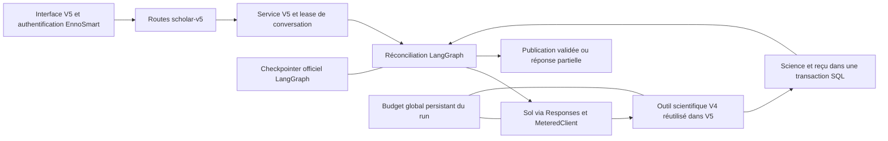

> Correction de démarrage : la commande initiale chargeait à tort le profil PostgreSQL général. Utiliser maintenant le profil explicite `local-v4` décrit ci-dessous. Le contrôle `--check-config` a été effectué sur l’installation existante sans démarrer l’application ; les empreintes de la base et des deux profils sont restées identiques.

# EnnoScholar V5 : intégration Sol / LangGraph — 27 octobre 2026

Cette livraison est limitée au worktree expérimental `codex/ennoscholar-v5-langgraph`. Aucun commit, push, déploiement, reset, serveur applicatif ou run scientifique réel n’a été lancé. Les modifications V4 déjà présentes avant cette intervention ont été conservées ; leurs empreintes ont été prises avant modification puis comparées.

## Architecture et liberté scientifique



Le nœud `decide` fait réellement un appel `client.with_options(...).responses.create(model="gpt-6.1-sol", stream=True, store=False)`. Le nœud `perform` exécute le choix de Sol. **Ni `original.run()` ni `ScholarChatAgent.run()` ne pilotent V5**, y compris pour les plans et la rédaction. Le graphe n’impose aucun enchaînement recherche → téléchargement → lecture → plan. Aucun LLM superviseur n’a été ajouté.

La configuration et les instructions scientifiques existantes sont réutilisées. La mention des six tours est remplacée uniquement dans le prompt transmis par V5. Le guide scientifique courant contient déjà le guide original : il est envoyé une seule fois, avec son complément de découverte. Un appel propose une fonction scientifique à la fois, avec des arguments pouvant traiter un lot ; les appels Web natifs restent disponibles. Il n’existe plus de plafond scientifique de six tours. La limite technique de récursion est dimensionnée au-delà des ressources disponibles et ne constitue pas une politique de recherche.

`agents/EnnoScholarV5/__init__.py` et `reuse.py` chargent les fichiers V4 existants dans un espace de modules V5. Les imports relatifs résolvent d’abord les adaptations V5. Cela réutilise les implémentations sans modifier les modules V4 chargés par V4. Les interfaces V5 sont une copie conservatoire des composants V4, raccordée exclusivement au client `/scholar-v5` ; cette copie devra suivre les futures évolutions de l’interface V4.

## Fonctionnalités raccordées

- Recherche native Web via Responses ; OpenAlex, Semantic Scholar et arXiv via les clients existants.
- Métadonnées, pagination des résultats, découverte par références/citations, décisions et classement scientifique par Sol, décisions du consultant.
- Récupération PDF/HTML/XML, accès légal, versions et vérification bibliographique ; continuation de l’extraction depuis les pages/offsets archivés.
- Lecture progressive, preuves exactes et leurs références de page, fiches scientifiques, comparaison et identification de lacunes.
- Outils existants de cadrage, faits du projet, plan, rédaction, revue, figures et export. Les validations V4 restent actives ; le raccordement ne garantit pas qu’un brouillon scientifiquement invalide sera accepté.
- Conversation, sélection/conservation/rejet d’articles, preuves, plan et manuscrit par les contrats API habituels, sous un préfixe V5 distinct.
- Reprise explicite du même run, avec le même identifiant et le même budget ; récupération d’un worker expiré sans redémarrage scientifique automatique.
- Mémoire V4 réutilisable en lecture seule par les outils explicites, avec les contrôles d’accès existants. Les décisions, plans, manuscrits et historiques V4 ne sont pas importés. Un PDF réutilisé est lu à son emplacement existant et son empreinte est contrôlée.

## Progression et réponses partielles

La projection distingue candidats non examinés, notices sélectionnées/rejetées, document absent ou disponible, extraction partielle et prochaine page, preuves proposées/lues/sauvegardées, fiche manquante et approfondissement restant. Les changements de plan, de manuscrit, de comparaisons, de verrous et de mémoire comptent aussi comme progression.

Sol choisit les travaux utiles et peut publier honnêtement une réponse partielle. La publication conserve les validations bibliographiques et de provenance. Deux opérations consécutives sans changement utile pour le même objectif provoquent une pause, pas une affirmation d’exhaustivité de la littérature. Un budget atteint, une annulation, une erreur ou une réponse fournisseur incertaine conserve les acquisitions et les tâches restantes. Une réponse partielle déterministe peut être produite sans payer un appel de synthèse supplémentaire.

Une nouvelle recherche ouverte sans référence explicite reçoit les métadonnées et la demande actuelle ; les anciennes analyses et réponses ne sont pas injectées automatiquement. Elles restent consultables par les outils. Une requête de continuation conserve son contexte scientifique.

## Ressources et non-répétition

Les plafonds sont ceux du profil V4 chargé, sans augmentation. Les valeurs par défaut restent **4 USD, 600 secondes actives, 400 000 tokens, 48 outils**, avec **4 appels Web natifs**, et les limites internes existantes de recherche, candidats, lecture, téléchargement, PDF et finalisation. Les anciens jobs segmentés V4 ne sont pas ouverts dans V5 : le run LangGraph utilise un budget unique, sans renouvellement automatique par nœud ou reprise.

`scholar_v5_budgets` fige les limites à la création de l’exécution. `MeteredClient` réserve avant le transport réel, puis règle avec la formule tarifaire existante et l’usage Responses reçu, cache et Web compris. Le registre V5 impose coût, tokens, outils, Web et temps même lorsque le contrôleur financier d’organisation est désactivé. Lorsque ce contrôleur est activé, il reste un second contrôle partagé de dépense. Une modification de configuration ne recharge pas un run existant.

Un flux interrompu sans usage connu conserve une réservation incertaine en coût et en tokens. Une réponse complète reçue avant une annulation est réglée avec son usage. Aucun réessai automatique ne repaye un appel incertain. Le rapprochement fournisseur d’un appel incertain reste manuel : le bouton de reprise explique ce blocage. Une reprise ne peut pas recharger un budget épuisé.

Les reçus réussis, les caches de recherches existants, les articles déjà identifiés, les documents archivés, les pages complètes et les passages déjà fournis sont réutilisés. Les écritures scientifiques restent idempotentes et les preuves conservent leurs identifiants. Une nouvelle question, un intervalle différent, une autre représentation justifiée ou une autre version reste possible. La déduplication n’assimile pas toutes les formulations sémantiquement voisines. Les requêtes internes de l’outil Web hébergé sont choisies au sein de Responses : elles ne sont pas interceptables avant leur exécution ; leurs sources sont mémorisées et leur usage est toujours compté. Il ne faut donc pas interpréter l’anti-redondance comme une garantie de déduplication sémantique universelle du Web natif.

## Persistance et isolation

La science est sauvegardée dans **la base configurée d’EnnoSmart**, via sa factory SQLAlchemy, dans les tables `scholar_v5_sessions`, `runs`, `messages`, `articles`, `session_articles`, `analyses`, `outlines`, `revisions`, `operations` et `budgets` (chaque nom porte le préfixe `scholar_v5_`). L’état scientifique et son reçu sont validés dans la même transaction. Un worker périmé ne peut pas écraser une conversation reprise par une autre exécution.

Pour PostgreSQL, le saver officiel utilise la même base et un schéma dédié **`ennoscholar_v5_langgraph`**. Son installation est déclenchée au premier run explicite ; le rôle PostgreSQL doit avoir les droits nécessaires. Pour SQLite, la science utilise la base applicative et les checkpoints utilisent un fichier V5 séparé, par défaut `backend_api/storage/scholar_v5/checkpoints/langgraph.sqlite3`. Le répertoire peut être fixé par `ENNOSCHOLAR_V5_CHECKPOINT_DIRECTORY` et doit être conservé entre redémarrages.

Les checkpoints contiennent identités, révisions, références, tâches, curseurs et compteurs. Ils ne contiennent ni PDF ni copie des textes intégraux. Les nouveaux PDF V5 sont conservés par empreinte dans `backend_api/storage/scholar_v5/pdf`, configurable par `ENNOSCHOLAR_V5_PDF_DIRECTORY`. Les informations scientifiques restent dans les enregistrements applicatifs.

La transaction du saver et la transaction applicative sont distinctes. Les reçus gèrent le cas d’un arrêt après le commit scientifique et avant le checkpoint. Cela ne fournit pas une garantie « exactement une fois » pour un appel externe dont la réponse a été perdue. Le rejeu d’un ancien checkpoint contre une science plus récente est refusé.

**Limite de validation : aucun PostgreSQL réel n’a été contacté.** La persistance et la restauration ont été exercées sur SQLite avec le saver officiel, dans une base temporaire. Les droits, la concurrence et les migrations du saver PostgreSQL doivent encore être validés dans l’environnement choisi. Aucun serveur ni navigateur applicatif n’a été redémarré pour cliquer dans l’interface : les routes sont testées en ASGI local sans socket, et le frontend est contrôlé par TypeScript.

## Corrections ciblées V5

- Équivalence bibliographique de `CO 2`, `CO₂`, `CO<sub>2</sub>` ; les véritables conflits DOI ou titre restent refusés.
- Reconnaissance de `STAR+METHODS` et `METHODS DETAILS`. Une extraction de continuation peut reprendre le dernier titre scientifique observé dans les chunks déjà archivés, sans réécrire les anciennes preuves.
- Mentions de tableaux/figures exclues des titres de sections.
- Conservation des pages PDF, libellés imprimés, offsets et références de preuves.
- Contexte d’une nouvelle recherche isolé des analyses historiques non demandées.
- Erreurs de métadonnées et de vérification isolées par article dans les lots.

Il ne s’agit pas d’une refonte d’extraction. L’interprétation visuelle des figures et les libellés PDF erronés à la source gardent leurs limites existantes.

## Validation hors ligne

Commande, depuis le worktree :

```powershell
& 'D:\EnnoSmart\.venv\Scripts\python.exe' -B experiments\ennoscholar_v5\run_offline.py --disable-warnings
```

Le runner bloque les connexions réseau, la résolution DNS, les sous-processus, la lecture des fichiers de secrets et l’écriture dans la base V4 réelle. Les écritures sont confinées au worktree. Le SDK OpenAI et son vrai chemin de streaming sont exécutés avec `httpx.MockTransport` ; aucun endpoint fournisseur n’est contacté.

Les tests couvrent notamment : neuf appels Responses simulés dont sept lectures utiles ; outils scientifiques existants ; véritables clients OpenAlex/Semantic Scholar/arXiv avec HTTP simulé ; Web natif simulé et tarifé ; reprise après crash après reçu ; interruptions et annulation ; reprise API du même run ; restauration de checkpoints ; plafonds persistants coût/tokens/temps/outils ; non-répétition d’une recherche ; conservation et sauvegarde de fiches/preuves ; plan, brouillon et renommage ; isolation V4/V5 et accès interutilisateurs ; mémoire V4 en lecture seule ; conflits bibliographiques ; sections scientifiques et réponse partielle.

**Chimie :** la fixture réelle contient 50 candidats, cinq publications proposées pour dix demandées et des textes non lus. Les lectures et une fiche sont sauvegardées à travers Responses/LangGraph ; le manque de cinq publications reste déclaré et persistant. Aucune découverte réelle supplémentaire n’est prétendue.

**Stokes :** le PDF local compte 29 pages et l’état initial n’en a extrait que vingt. Les pages 21–29 sont réellement extraites du fichier local, leurs coordonnées sont conservées, les passages de méthodes deviennent consultables et l’ancienne analyse ainsi que les anciennes preuves restent identiques. Extraction complète ne signifie pas lecture exhaustive ni validation scientifique par un modèle réel.

Les décisions des modèles sont simulées. Ces tests établissent le raccordement et ses contrôles, pas la qualité d’un premier travail scientifique réel avec Sol. Le résultat final et les empreintes sont consignés dans `experiments/ennoscholar_v5/INTEGRATION_RESULTS.md` et `.artifacts/tests.xml`.

## Démarrage local par le consultant

Les dépendances LangGraph isolées existent déjà dans `experiments/ennoscholar_v5/.deps`. Le lanceur les utilise sans modifier le Python V4. Leurs versions sont dans `requirements-prototype.txt`. Le frontend du worktree dispose maintenant d’un véritable répertoire `frontend/node_modules` sur C:, copié hors ligne depuis les dépendances déjà installées dans `D:\EnnoSmart\frontend\node_modules` (26 557 fichiers, environ 450 Mio). La jonction initiale entre C: et D: a été retirée : elle empêchait la résolution des fichiers clients Next.js avec Turbopack puis Webpack. Les dépendances source sur D: n’ont pas été modifiées et aucun téléchargement n’a été effectué. Le script `dev:v5` sélectionne Webpack. L’ancienne jonction et le cache de compilation défaillant sont archivés sous `.artifacts`, hors du frontend.

La compilation réelle `next build --webpack --experimental-build-mode compile` a réussi en 50 secondes, avec le flag V5 actif, les connexions HTTP/DNS/TCP/fetch bloquées et la télémétrie désactivée. TypeScript a également réussi avec les dépendances locales sur C:. Ce contrôle ne démarre pas le serveur et n’exécute pas la génération finale des pages. Le script `scripts/check_ennoscholar_v5_frontend.cjs` fournit le garde réseau de cette validation ; il n’est pas chargé par `dev:v5`.

Dans un premier terminal PowerShell :

```powershell
Set-Location 'C:\Users\hp\.codex\worktrees\ennoscholar-v5-langgraph\EnnoSmart'
& 'D:\EnnoSmart\.venv\Scripts\python.exe' -B .\scripts\start_ennoscholar_v5.py --profile local-v4 --env-file 'D:\EnnoSmart\.env' --port 8002
```

Le profil `local-v4` correspond au lanceur V4 effectivement installé : il utilise la base existante `C:\Users\hp\.codex\worktrees\ennoscholar-v4\EnnoSmart\ennoscholar_v4_test.db` et le fichier OpenAI local `C:\Users\hp\.codex\runtime\ennoscholar-v4\openai.local.env`. Le fichier `D:\EnnoSmart\.env` fournit seulement les paramètres d’authentification et de fournisseurs autorisés ; sa configuration PostgreSQL et sa clé OpenAI générale sont ignorées. Le modèle reste `gpt-6.1-sol` et les plafonds sont ceux du lanceur local V4. Une base absente, vide ou sans les tables V4, une clé locale absente ou un autre modèle provoquent un refus explicite ; aucune base vide ni clé de secours n’est utilisée.

Le lanceur ne démarre aucun run scientifique. Il ferme la porte de reprise automatique du watchdog V4 ; les demandes manuelles V4 restent possibles. Le démarrage local crée seulement les tables `scholar_v5_*` manquantes : il n’applique pas les migrations des tables V4 ou communes. Les connexions SQLite utilisent `mode=rw` pour refuser une recréation silencieuse si le fichier est déplacé. Les documents V4 sont lus depuis leur emplacement existant ; les nouveaux documents et checkpoints V5 restent dans le stockage V5.

Contrôle facultatif en lecture seule, sans démarrer l’application :

```powershell
& 'D:\EnnoSmart\.venv\Scripts\python.exe' -B .\scripts\start_ennoscholar_v5.py --profile local-v4 --env-file 'D:\EnnoSmart\.env' --check-config
```

Le mode `--profile env` reste disponible pour un profil applicatif volontairement configuré, y compris PostgreSQL ; il ne remplace jamais automatiquement la base locale. Il n’est pas nécessaire pour cette installation locale.

Dans un second terminal PowerShell :

```powershell
Set-Location 'C:\Users\hp\.codex\worktrees\ennoscholar-v5-langgraph\EnnoSmart\frontend'
$env:NEXT_PUBLIC_API_URL = 'http://127.0.0.1:8002'
$env:NEXT_PUBLIC_ENNOSCHOLAR_V5_TEST_ENABLED = '1'
npm.cmd run dev:v5 -- --hostname 127.0.0.1 --port 3000
```

Ouvrir [EnnoSmart local](http://127.0.0.1:3000), se connecter avec le compte habituel, puis ouvrir EnnoScholar. Le menu **Moteur de test** affiche **V4** par défaut. Choisir **V5 · Sol + LangGraph**, créer une conversation V5, puis envoyer soi-même la première demande. Aucun passage en V5 n’est appliqué à une conversation V4 existante.

Pour reprendre : ouvrir l’historique V5, sélectionner sa conversation, puis **Reprendre V5** lorsqu’une exécution interrompue est disponible. Le budget et les reçus du même run sont conservés. Les appels incertains et budgets épuisés ne sont pas relancés automatiquement ; une nouvelle demande explicite ouvre une autre exécution et conserve les acquisitions précédentes.

## Retour à V4 sans perte

Choisir **V4** dans le menu : l’historique V4, ses plans et ses manuscrits réapparaissent, sans migration. Le changement d’affichage n’annule pas une exécution V5 en cours ; utiliser son bouton d’arrêt si souhaité.

Pour masquer entièrement V5, arrêter les processus de test, retirer `NEXT_PUBLIC_ENNOSCHOLAR_V5_TEST_ENABLED` du terminal frontend, puis redémarrer le frontend. Utiliser le lanceur V4 habituel pour retrouver son fonctionnement habituel et son watchdog. Sans `ENNOSCHOLAR_V5_TEST_ENABLED=1`, le backend ne monte pas les routes V5. Ne supprimer aucune table, aucun fichier de checkpoint et aucun répertoire documentaire : les données V5 resteront disponibles pour un retour ultérieur.

## Fichiers ajoutés ou modifiés par cette intégration

- `agents/EnnoScholarV5/` : espace de réutilisation, configuration, science adaptée, service, mémoire, stockage, registres applicatifs et budget.
- `experiments/ennoscholar_v5/{adapter,graph,progress,policy}.py` : port Responses autorisé, usage/incertitude, échanges de protocole et progression des livrables ; tests initiaux conservés.
- `experiments/ennoscholar_v5/tests/test_live_integration.py` : validation SDK/API/persistance/outils de production simulés.
- `backend_api/routers/scholar_v5.py` et `backend_api/main.py` : montage conditionnel des routes V5 et initialisation limitée aux tables V5 pour le profil SQLite local.
- `frontend/components/ennosmart/v5/`, `frontend/lib/scholar-v5.ts`, `scholar-engine-selector.tsx` : interface séparée, sélection et reprise.
- `frontend/lib/api.ts` : ajout des transports V5 ; `app-shell.tsx` : entrée par le sélecteur, qui garde V4 par défaut.
- `scripts/start_ennoscholar_v5.py` et `agents/EnnoScholarV5/startup.py` : démarrage explicite, reprise du profil local V4, contrôle en lecture seule et absence de migrations V4.
- Ce rapport, le README de l’expérience et `INTEGRATION_RESULTS.md`.

La maintenance de l’espace de modules réutilisés dépend de la compatibilité des imports relatifs V4. Toute future évolution V4 devra repasser les tests V5. Les autorisations PostgreSQL, le comportement interactif complet dans le navigateur et la qualité/coût du premier run réel Sol restent à vérifier par le consultant.
