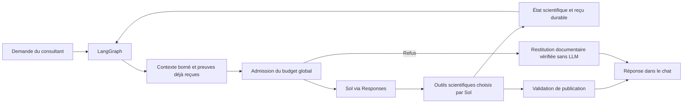

# Stabilisation transversale V5 — diagnostic, corrections et validation hors ligne

Sauvegarde préalable : `C:\Users\hp\AppData\Local\Temp\ennoscholar-orchestration-stabilisation-n56h9_i2`.
Branche : `codex/ennoscholar-v5-langgraph`. Les modifications V4 déjà présentes avant cette intervention ne sont ni corrigées ni annulées.

## Matrice établie avant modification

| Parcours | Transition contrôlée | Couverture initiale / limite | Cause confirmée à traiter |
|---|---|---|---|
| Recherche simple, approfondie, plusieurs résultats, résultats insuffisants | Responses → sources → registre → sélection | Tests live_integration/adaptive ; Sol scénarisé, aucun fournisseur réel | Web doit être fermé à son plafond sans bloquer les opérations sans Web |
| HTML, JATS, PDF, accès refusé, cache local | get_fulltext → identité → extraction → document | Extraction validée sur fixtures ; rejet HTML MDPI réel non reproduit | Raccourci archived_document antérieur au contrôle de version HTML |
| Première lecture, même session, intersessions, ancienne extraction | registre → actualisation → snapshots → outils | Tests html_currency ; source intersessions préservée | Ne pas contourner l’actualisation par la réutilisation |
| Texte, tableaux, figures, références graphiques | outil read → reçu présenté → contexte → publication | Deux runs réels + sondes indépendantes | Légende non quantifiée oubliée ; URL graphique obtenue mais refusée |
| Lecture progressive / pagination / IDs | index → read → curseurs → couverture | Tests stokes_depth/extraction ; N05 et F05 restent ouverts | Index réordonné faussement crédité ; ne pas prétendre corriger les identités N05 |
| Analyse initiale, approfondissement, mise à jour | read → save → fiche → nouvelle question | Tests scientific_chain, sans certifier les contrôles scientifiques N06–N10 | Maintenir les preuves déjà reçues, sans fabriquer une analyse |
| Comparaison multiarticles | fiches → matrice → relations → réponse/dossier | Tests comparison_memory/scientific_chain ; F01–F13 non réputés résolus | Maintien du contexte commun ; ne pas assouplir fraîcheur ou attribution scientifique |
| Planification / rédaction / sections | plan validé → dossier → write_section → brouillon | Tests writing_scope/cir_workflow/drafting_mission | Préserver périmètre et sauvegardes ; ne pas imposer save_analysis à une extraction sans analyse |
| Interruption / redémarrage / reprise | reçu durable → checkpoint → compteur → outil | Tests graph/live_integration ; crash et reprise simulés | Réutiliser reçus et mémoire de demande, aucun budget remis à zéro |
| Tokens, dollars, temps, outils, Web et réservations | admission → transport → règlement → arrêt | Tests bloc 3 / S2 ; pas de facture réelle | Une dette Web empêche à tort une opération à zéro Web ; bilan vérifié absent à l’arrêt |
| Timeout, réponse vide, outil/ID absent, preuve invalide, URL refusée | erreur → reçu → service → message | Tests S2 et erreurs ; cas combinés à ajouter | Préserver résultats courants sans réafficher une ancienne réponse ou autoriser des liens libres |

## Dépendances scientifiques laissées ouvertes

N05 : les IDs des preuves dépendent encore de la couverture extraite. N06–N10 : incohérences de vues, d’intégrité/fraîcheur et de provenance décrites dans l’audit transversal restent à examiner dans leurs blocs. F01–F13 : attribution des chiffres, preuves secondaires, fraîcheur des verrous/matrices, curseurs, comparabilité, contrats historiques et unicité des relations ne sont pas réputés corrigés par cette intervention. La continuité de contexte doit utiliser les vérifications existantes et signaler ses limites, sans valider artificiellement ces objets.

## Validation prévue

Tests permanents des transitions complètes, puis suite V5 entière, uniquement SDK Responses sur transport simulé et SQL temporaire. Aucune requête réelle, aucun changement de plafonds, aucune migration V4/V5, aucun redémarrage de l’application. Résultats et gains de volume à compléter après exécution.
## Causes confirmées et corrections appliquées

| Défaut | Gravité | Correction V5 | Vérification attendue |
|---|---|---|---|
| Preuve reçue perdue du contexte après d’autres outils | Haute | `consulted.py` : références de demande courante, citations exactes contrôlées dans les snapshots ; vue bornée dans `ScientificAdapter.prepare`, y compris finalisation | Figure + tableau → autres outils → synthèse normale et forcée |
| Contexte obligatoire de rédaction privé de place par une mémoire facultative | Haute, régression détectée pendant cette intervention | Allocation locale avec repli sur l’enveloppe obligatoire et restauration des fenêtres préparées ; aucune hausse du budget | Missions complètes, sections antérieures inchangées, limite du contexte réellement transmis |
| Même index crédité après permutation, filtre ou pagination différente | Haute | `workflow.delivery_keys` : identité de chaque localisateur/source, pas identité de sa liste ordonnée | Aucun nouveau crédit pour ordre/offset/filtre/sous-ensemble ; nouveaux passages et nouvelle source acceptés |
| Ancien HTML servi avant contrôle de version | Moyenne | Hook V5 `before_reuse` avant `policy.reusable`, réextraction locale existante | get_fulltext sur archive ancienne sans téléchargement ; ancienne preuve encore exacte |
| Référence graphique littérale rejetée | Haute | Surcharge `publication.py` utilisant la whitelist existante ; seuls liens de figures provenant de preuves citées, présentées et exactes sont ajoutés à la vue de validation | URL réellement extraite publiée ; URL inventée, preuve invalide ou non présentée refusée |
| Web consommé empêchant une opération à zéro Web | Haute | Admission et compteurs distinguent ressources demandées ; zéro Web n’engage aucune unité Web supplémentaire | Web 4/4 puis lecture/finalisation locale ; unités déjà consommées conservées |
| Réponse fournisseur contenant plus de Web que l’unité demandée | Haute, contrat externe non attesté | Identifiants/types/nombre d’actions tracés ; compteur réel conservé et accès Web fermé au plafond | Simulation conforme 4/4 et simulation adversariale 5/4 ; aucun Web supplémentaire proposé après cette dernière |
| Résultats courants masqués à l’arrêt | Haute | Restitution documentaire déterministe des seules preuves exactes reçues pour cette demande ; notification d’arrêt ou d’erreur conservée en tête | Tokens/dollars/temps/outils, erreur après lecture ; pas d’ancienne réponse ni sauvegarde fictive |
| Réponse fournisseur vide publiée comme réussite ou relancée | Moyenne | `ProviderEmptyResponse`, règlement de l’appel conservé et arrêt explicite sans nouvel appel | Un seul HTTP simulé ; résultat technique partiel, aucune couverture annoncée |
| save_analysis suggéré malgré consultation sans analyse | Moyenne | Projection des tâches respecte `no_reanalysis` / profondeur documentaire ; pas de suppression de fiches | Aucune tâche imposée, aucune analyse fabriquée |
| Métadonnées de schémas volumineuses | Coût / amélioration limitée | Suppression des seuls titres d’interface Pydantic ; champs, required, contraintes, descriptions, outils et guide scientifique conservés | Équivalence des schémas utiles et mesure des octets/estimations |

Le dépassement fournisseur adversarial n’est pas maquillé en 4/4 : on ne peut pas annuler des actions déjà effectuées à distance. Le code conserve le 5/4 et le diagnostic ; il ne donne aucune autorisation d’utiliser davantage de Web. La garantie d’un plafond absolu côté fournisseur reste liée au respect effectif de `max_tool_calls=1`, déjà envoyé auparavant et inchangé. Aucun budget ni plafond n’a été augmenté.

Une vue bornée ne peut contenir tous les textes intégraux. Les projections sont entières, les omissions explicites et leurs identifiants conservés ; les données restent dans leur stockage d’origine. Un passage disponible ou présenté ne devient pas pour autant une analyse suffisante. La restitution à l’arrêt est un extrait documentaire avec sa provenance, sans nouvelle interprétation scientifique ni comparaison automatique.

## Périmètre laissé intact

L’extracteur HTML/JATS/PDF, les prompts scientifiques, les modèles de preuve et les contrôles de comparaison ne sont pas refaits. Les titres JSON Schema retirés sont des métadonnées d’affichage, pas le champ scientifique `title`. Les définitions et descriptions de tous les outils restent accessibles à Sol. Le superviseur, les nœuds LangGraph, les missions, l’approbation du plan et les compteurs globaux sont conservés.

Cette intervention ne corrige pas : N05 (IDs dépendant de la couverture), N06 (copies/autorité des preuves), N07 (fraîcheur des revues), N08 (qualification de préparation), N09 (correction versus enrichissement), N10 (attribution sémantique des mesures). Elle ne valide pas non plus F01–F13 : attribution des nombres, preuves secondaires, fraîcheur des verrous/matrices, curseurs, portée des dossiers, décisions négatives, comparabilité, ancien contrat conclusions, partenaires distincts, unicité des relations et des verrous. La continuité ajoutée réutilise l’intégrité existante des citations exactes ; elle ne vaut pas certification de ces objets scientifiques.

## Historique de validation

- Contrôles initiaux : 54 tests existants ciblés réussis.
- Première série des transitions : 20 nouveaux tests réussis.
- Transitions combinées avec comparaison, contexte et portée des sections : 87 tests réussis.
- Une première exécution complète répartie a été interrompue après détection de la régression d’allocation du contexte de mission. Aucun résultat partiel de cette exécution ne sert de preuve de validation finale.
- Après correction de cette allocation : nouvelle exécution complète sur version corrigée, en cours. Les résultats définitifs seront ajoutés ci-dessous.

## Compléments issus de la suite complète

La validation intermédiaire complète a exécuté 591 tests : 585 réussites et 6 échecs. Elle n’est pas présentée comme une validation finale réussie.

- La projection des tâches supprimait aussi les nouveaux candidats lors d’une nouvelle recherche : corrigé par la liste des articles présents au début de la demande et les IDs des candidats retournés pour cette demande, y compris par un reçu réutilisé. Aucun ancien texte d’analyse n’est injecté par cette liste d’IDs. Trois tests distinguent découverte, réutilisation explicite et ancien état sans ce nouveau champ.
- Trois assertions de l’ancien essai exigeaient au maximum deux appels, alors que les coûts, tokens, outils et portée restaient sous leurs limites. Le schéma réduit peut légitimement admettre un troisième appel. Le test vérifie maintenant l’arrêt du script improductif et les plafonds réels, sans imposer un nombre fixe de tours. Aucune limite de production n’a été relevée.
- Deux exécutions ont renvoyé `OperationalError` sous quatre groupes concurrents. Elles ne se reproduisent pas dans la relance ciblée en série ; leur origine exacte n’est pas confirmée. Aucun délai SQL ni plafond applicatif n’a été augmenté pour les masquer. La validation finale réduit la concurrence du harnais.
- Un indicateur d’erreur fournisseur pouvait masquer une tentative ultérieure réussie du même run : le nouvel essai efface cet indicateur transitoire, tout en conservant activité, messages, reçus et compteur. Deux tests de reprise explicite couvrent HTTP 401 et réponse vide ; ils vérifient le même run, les anciennes entrées intactes et l’absence de remise à zéro.

Les 27 tests ciblés des régressions corrigées ont réussi. La reprise des deux erreurs SQL et les tests de portée font partie de ce contrôle. Les deux nouveaux tests de reprise fournisseur ont aussi réussi.

## Mesure des ressources hors ligne

Sur les mêmes définitions d’outils et instructions, le bloc des schémas passe de **78 996 à 67 018 octets**, soit **11 978 octets / 15,16 %** de moins. La requête témoin (sans contexte scientifique variable) passe de **33 776 à 29 783 tokens d’entrée estimés** : **3 993 tokens estimés** de moins. L’estimateur n’est pas un tokenizer fournisseur attesté ; aucun gain de facturation n’a été mesuré.

Les 22 329 octets du guide complet restent conservés. Tous les outils, champs, descriptions scientifiques et plafonds restent présents. Le maintien des preuves utilise l’enveloppe de contexte existante ; il peut augmenter la part utile de cette enveloppe selon le dossier. Il serait donc faux de généraliser le gain de schémas à chaque requête complète ou à une économie réelle garantie.

Le parcours témoin recherche → acquisition → lecture → publication exécute quatre appels Responses simulés, une recherche, une acquisition et une lecture. C’est une mesure du scénario scénarisé, pas la preuve qu’un vrai Sol choisira toujours quatre appels. Les tests d’index vérifient que permutations et sous-fenêtres ne créent plus de crédit supplémentaire. Les lectures motivées et nouvelles sources restent ouvertes.

## Interface et conservation

Rendu hors ligne du véritable composant Response et de ReactMarkdown : **41 messages API visibles**, messages S2 et références graphiques inclus. Le contrôle final reprend les sorties de la dernière validation, dont publication après refus d’une URL inventée, arrêt tokens et HTTP 401 après lecture. Aucun serveur, navigateur ou frontend de développement n’a été démarré. Ce contrôle SSR ne certifie pas les interactions visuelles d’un navigateur réel.

Contrôle de conservation effectué pendant cette validation : **409 fichiers préexistants contrôlés**, aucune modification hors V5/tests associés ; **45 tables applicatives, contenus et nombres de lignes inchangés**. Les 58 fichiers V4, les extracteurs et les configurations restent inchangés. Les processus du backend réel observés conservent leurs identifiants et leur heure de démarrage ; ils n’ont pas été redémarrés par cette intervention.

## Conditions avant un essai réel

1. Lire le résultat définitif de la suite complète ci-dessous et les limites de couverture ; ne pas confondre simulations et validation scientifique réelle.
2. Le consultant redémarre lui-même son backend pour charger les nouveaux modules Python ; cette intervention ne lance pas de run réel.
3. Commencer par un parcours documentaire court, une seule exécution à la fois, avec les plafonds actuels et vérification des messages, preuves, URLs et compteurs.
4. Observer le nombre réel d’actions Web renvoyées et le respect effectif du paramètre de limitation fournisseur. La simulation adversariale conserve et signale un dépassement ; elle ne prouve pas que le fournisseur ne puisse jamais dépasser ce qui lui est demandé.
5. Avant de qualifier comparaison ou rédaction scientifiquement stables, traiter séparément les dépendances N05–N10 et F01–F13 décrites plus haut. La présente correction n’efface pas ces problèmes.

## Flux conservé

Sol choisit les recherches, lectures, analyses, comparaisons et textes. Python contrôle les autorisations, ressources, reçus, versions d’extraction, intégrité des citations, portée de rédaction et sauvegardes. La mémoire ajoutée est une vue des preuves de la demande courante, pas un nouveau superviseur scientifique. Aucun appel au moteur de run V4 n’a été ajouté ; V5 conserve sa propre boucle LangGraph avec les composants scientifiques V4 réutilisés sous son namespace.

## Fichiers et points d’entrée modifiés

| Fichier | Modification |
|---|---|
| [agents/EnnoScholarV5/consulted.py](C:/Users/hp/.codex/worktrees/ennoscholar-v5-langgraph/EnnoSmart/agents/EnnoScholarV5/consulted.py:10) | Mémoire commune et restitution documentaire : références de la demande, projections exactes, omissions, liens graphiques |
| [agents/EnnoScholarV5/publication.py](C:/Users/hp/.codex/worktrees/ennoscholar-v5-langgraph/EnnoSmart/agents/EnnoScholarV5/publication.py:10) | Surcharge de validation des références graphiques ; pas de suppression des contrôles V4 |
| [agents/EnnoScholarV5/runtime.py](C:/Users/hp/.codex/worktrees/ennoscholar-v5-langgraph/EnnoSmart/agents/EnnoScholarV5/runtime.py:455) | Assemblage borné, allocation locale, diagnostics natifs, erreur vide et état d’une nouvelle tentative |
| [agents/EnnoScholarV5/persistence.py](C:/Users/hp/.codex/worktrees/ennoscholar-v5-langgraph/EnnoSmart/agents/EnnoScholarV5/persistence.py:264) | Contrôles Web appliqués aux opérations qui demandent du Web ; tous les autres axes inchangés |
| [agents/EnnoScholarV5/service.py](C:/Users/hp/.codex/worktrees/ennoscholar-v5-langgraph/EnnoSmart/agents/EnnoScholarV5/service.py:456) | Restitution courante après arrêt et liste des articles présents au début de la demande |
| [agents/EnnoScholarV5/toolkit.py](C:/Users/hp/.codex/worktrees/ennoscholar-v5-langgraph/EnnoSmart/agents/EnnoScholarV5/toolkit.py:41) | Schémas stricts sans titres Pydantic redondants |
| [agents/EnnoScholarV5/workflow.py](C:/Users/hp/.codex/worktrees/ennoscholar-v5-langgraph/EnnoSmart/agents/EnnoScholarV5/workflow.py:843) | Crédit par localisateur et reçus des preuves réellement transmises |
| [experiments/ennoscholar_v5/graph.py](C:/Users/hp/.codex/worktrees/ennoscholar-v5-langgraph/EnnoSmart/experiments/ennoscholar_v5/graph.py:289) | Actualisation locale de version avant raccourci d’archive |
| [experiments/ennoscholar_v5/progress.py](C:/Users/hp/.codex/worktrees/ennoscholar-v5-langgraph/EnnoSmart/experiments/ennoscholar_v5/progress.py:132) | Tâches compatibles avec le besoin ; candidats nouveaux et réutilisés conservés |
| [experiments/ennoscholar_v5/tests/test_orchestration_reliability.py](C:/Users/hp/.codex/worktrees/ennoscholar-v5-langgraph/EnnoSmart/experiments/ennoscholar_v5/tests/test_orchestration_reliability.py:80) | 37 cas nouveaux, dont transitions complètes sur le vrai SDK simulé |
| [experiments/ennoscholar_v5/tests/test_scope_trial.py](C:/Users/hp/.codex/worktrees/ennoscholar-v5-langgraph/EnnoSmart/experiments/ennoscholar_v5/tests/test_scope_trial.py:159) | Contrôle des plafonds plutôt qu’un nombre arbitraire de deux appels |

Les sauvegardes préalables et le diff de contrôle sont conservés dans le répertoire temporaire de stabilisation indiqué au début du rapport. Le présent rapport est le douzième fichier ajouté/modifié ; aucun fichier V4 ni frontend n’a été changé.

## Raccordement aux deux échecs réels

Le diagnostic initial s’appuie sur l’[audit indépendant des runs A et B](C:/Users/hp/.codex/audits/ennoscholar-v5/2026-10-30-runs-ac816f8e-4bb9d33a/audit-independant.md). Les données suivantes sont historiques ; aucune nouvelle exécution scientifique n’a été lancée pour cette intervention.

| Run réel | Constat démontré | Cause initiale / contrôle / conséquence | Reproduction permanente |
|---|---|---|---|
| A `ac816f8e296f447c87dfb6e6b488b03a` | 14 Responses, 332 813 tokens, 0,3048574 $ enregistrés ; légende de figure effectivement reçue mais déclarée absente en finale | `ScientificAdapter.prepare` + `workflow.working_memory` maintenaient surtout les fiches et phrases quantifiées, sans vue commune des légendes reçues ; `delivery_keys` créditait à nouveau une liste d’index réordonnée ; réservation de synthèse atteinte après les répétitions | `test_figure_and_table_survive_other_tools_and_reach_final_response`, en synthèse normale et forcée ; `test_index_progress_is_per_locator_not_order_filter_or_window` |
| B `4bb9d33a2d6b485a991e6a6a709d0e35` | 5 Responses, 134 256 tokens, 0,1618857 $ enregistrés ; 5 Web pour un plafond de 4 ; document et cellules sauvegardés | Multiplicité native distante d’origine non confirmée ; `_check_scope` / `admit` / `record_tools` appliquaient ensuite `5+0>4` à une opération sans Web ; `ScholarV5Service.execute` ne restituait pas les passages déjà reçus | `test_web_exhaustion_preserves_local_reading_and_finalization` avec réponses conformes puis adversariales ; `test_resource_stop_restitutes_current_verified_quotes_without_extra_http` |
| Défaut complémentaire, pas cause historique prouvée de A | Référence graphique exacte refusée par `unknown_url` dans une sonde hors ligne | Le validateur de publication réutilisé ne reconnaissait pas les références graphiques issues des snapshots ; surcharge au point d’entrée `publication.publish`, sans élargir aux URL arbitraires | `test_graphic_publication_rejects_invented_url_and_reaches_chat_api` et quatre rejets de références non autorisées |

Les 467 069 tokens et 0,4667431 $ de conversation correspondent au cumul A+B, sans double comptage démontré. A s’arrêtait sur une réservation de tokens, pas sur épuisement des dollars. Le HTML corrigé de A était bien extrait : il n’a pas été réécrit pour résoudre un défaut apparu plus tard dans la chaîne. L’absence des corps complets des anciens appels empêche de rejouer les choix exacts du fournisseur ; les reproductions portent sur les transitions et erreurs démontrées.

## Matrice de couverture finale : portée des preuves

« Intégration simulée » signifie que le service V5, LangGraph, les outils, les reçus SQL et le SDK Responses réels sont exécutés, avec réponses HTTP scénarisées et stockage temporaire. Cela ne constitue pas un appel à Sol ni un jugement de qualité scientifique.

| Parcours | Preuve permanente principale | Niveau effectivement exercé | Limite restante |
|---|---|---|---|
| 1. Recherche et sélection | `test_live_integration::test_real_scientific_provider_clients_use_simulated_http_and_reuse_search`, `test_ten_articles_run`, nouveau `test_search_index_read_and_answer_choose_only_from_actual_responses_inputs` | Clients académiques sur HTTP simulé ; intégration recherche → document → index → passages → finale ; candidats nouveaux, anciens réutilisés et legacy distingués | Les recherches « approfondies » et la pertinence des sélections restent des décisions scénarisées ; aucun classement réel attesté |
| 2. Récupération HTML/JATS/PDF, cache et refus | `test_extraction_step1::test_acquisition_to_versioned_table_and_figure_reading_through_langgraph`, `test_live_integration::test_stokes_remainder_uses_same_pdf_and_preserves_page_metadata`, `test_document_failures` | Intégration acquisition/lecture pour fixtures ; récupération des neuf pages restantes ; erreurs d’accès et alternatives testées au niveau outil | Pas de nouvel accès éditeur, de document payant ni de téléchargement réseau ; contrôle d’accès non contourné |
| 3. Mémoire même session/intersessions et versions | `test_archived_html_is_refreshed_before_graph_reuse`, `test_html_currency`, `test_live_integration::test_explicit_reuse_of_v4_science_is_read_only_and_avoids_new_downloads` | Intégration cache/version HTML et réutilisation ; snapshots historiques exacts conservés ; nouveau sujet exclu de la mémoire consultée | N05–N07 restent ouverts ; aucun déploiement ni migration sur la mémoire réelle |
| 4. Lecture, tableaux, figures, IDs et pagination | Nouveaux tests figure/tableau, index, `test_html_floats`, `test_stokes_depth` | Lecture et publication de cellules, légendes et références graphiques via SDK/service/API ; index sans nouveau crédit après permutation ; pagination PDF existante contrôlée | Pas de compréhension visuelle des pixels ; localisation et curseurs N05/F05 non résolus ; affichage distant de l’image non attesté |
| 5. Analyse, enrichissement et profondeur | `test_scientific_chain::test_scripted_science_chain_through_responses_graph_and_resume`, `test_claim_and_comparison_proofs_are_retained_by_the_same_received_material_view` | Intégration scientifique scénarisée existante ; nouveau contrôle de continuité commun aux preuves d’analyse et de comparaison | Le nouveau contrôle multi-outils seul n’est pas une nouvelle validation bout en bout de toutes les analyses ; N06–N10 restent ouverts |
| 6. Comparaison multiarticles | `test_comparison_memory`, `test_scientific_chain` et maintien des preuves consultées | Relations validées/sauvegardées/retrouvées, réponses forcées et refus existants sur fixtures ; pas d’assouplissement du validateur | F01–F13 restent ouverts ; un test vert sur une fixture ne valide pas l’attribution ou la comparabilité générale |
| 7. Planification et rédaction | `test_drafting_mission`, `test_ready_section_drafting`, `test_cir_workflow`, `test_writing_scope`, `test_plan_edit_scope` | Missions et sections scénarisées avec persistance ; contexte obligatoire préservé ; modification ciblée et plan approuvé conservés | Aucune rédaction scientifique réelle ; qualité et exhaustivité du manuscrit non certifiées |
| 8. Interruption, checkpoint et reprise | `test_crash_after_read_commit_restores_memory_without_repeating_read_or_budget`, tests de reçu/reprise de `test_live_integration` | Exceptions injectées après commit, reprise des vrais reçus/checkpoints SQL temporaires ; aucune seconde lecture ni remise à zéro ; reprise explicite après erreur fournisseur | Pas de crash système ni de test PostgreSQL ; les garanties hors des points injectés ne sont pas attestées |
| 9. Ressources et réservations | `test_block3_*`, `test_s2_stop_messages`, nouveaux tests ressources et Web | Admission avant HTTP, règlement des usages simulés, reprise et refus ; aucun plafond rehaussé ; Web fermé au plafond sans interdire le local | Pas de facture réelle ; un fournisseur qui renvoie trop d’actions a déjà dépassé son autorisation : dépassement conservé et signalé, pas rendu impossible par ce client |
| 10. Erreurs et restitution | Nouveaux tests réponse vide, erreur après lecture et reprise HTTP 401/vide ; `test_s2_stop_messages` ; script SSR existant | Intégration service/API et rendu SSR du vrai composant ; preuves actuelles restituées, erreur visible, ancienne réponse non recyclée | Pas de navigateur interactif ; les erreurs d’outil/ID invalide ont une couverture surtout unitaire et de non-régression, pas toutes un scénario complet combiné |

Le scénario supplémentaire fondé uniquement sur les sorties effectivement transmises choisit les IDs et les lectures sans accès privé à la base : cinq Responses simulés, une recherche, une acquisition, un index et une lecture. Il complète le scénario à quatre appels avec sélection directe des passages. Ces nombres sont des mesures de scripts, pas des plafonds de tours ni des promesses sur un vrai Sol.

## Dépendances à traiter séparément, par origine

Cette liste reprend les défauts des audits antérieurs. Elle n’est ni une nouvelle validation exhaustive de leurs reproductions, ni une déclaration qu’ils seraient tous corrigés. Les numéros N/F ne doivent pas être remplacés par les tests verts de cette intervention.

| Origine du contrat à stabiliser | Défauts concernés | Conséquence pour la présente livraison | Ordre conseillé |
|---|---|---|---|
| Gestion des preuves et identité physique | N05, N06 ; dépendances secondaires F02 | Les nouveaux crédits d’index restent dépendants des IDs existants ; une extension de couverture peut encore créer de nouveaux IDs. La mémoire vérifie le registre et le snapshot actuels, sans réconcilier les copies historiques | 1 : identité/autorité et dépendances des preuves |
| Lecture et fraîcheur des constats | N07, F05 | La continuité des passages ne corrige ni la suffisance d’une revue devenue obsolète ni le curseur des affirmations filtrées | 2 : consommation et invalidation cohérentes |
| Sauvegarde scientifique et attribution | N09, N10, F12, F13 | Les reçus d’une même opération restent idempotents ; cela ne prouve pas l’unicité sémantique de deux écritures différentes, ni une correction d’interprétation, ni le bon rattachement valeur/unité | 3 : contrat des fiches, mesures, verrous et relations |
| Comparaison et orchestration de ses identités | F01, F03, F04, F07, F08, F09, F10, F11 | La preuve reste consultable, mais l’attribution, la fraîcheur des matrices/verrous, les décisions négatives, les signatures administratives et le contrat historique restent à vérifier dans leur bloc | 4 : contrôles scientifiques et réutilisation alignés sur les contrats précédents |
| Préparation de rédaction | N08, F06 | Conserver le contexte et sauvegarder une section ne certifie pas que son qualification fulltext ou sa portée comparative soit suffisante | 5 : qualification des dossiers, sans modifier automatiquement les brouillons |

Références détaillées : [audit transversal et localisation des causes](C:/Users/hp/.codex/audits/ennoscholar-v5/2026-10-30-orchestration/references/audit-transversal.md:105), [audit du bloc Comparaison](C:/Users/hp/.codex/audits/ennoscholar-v5/2026-10-30-orchestration/references/audit-bloc2.md:133). Copies des rapports antérieurs, sans modification de leurs originaux. Leurs points d’entrée et lignes décrivent leur version auditée ; les insertions de cette intervention ont décalé certaines lignes. Aucun changement de logique de ces contrats n’est revendiqué ici.

## Résultat définitif de la validation

**597 cas distincts réussis, aucun échec, aucune erreur ni test ignoré dans la validation finale.** Ils correspondent à 560 cas préexistants et 37 nouveaux cas permanents. L’inventaire des 35 modules de tests V5 est intégralement couvert.

| Exécution finale | Résultat | Durée du groupe | Portée |
|---|---:|---:|---|
| Groupe 1 | 332 PASS | 2 454,544 s | Missions, mémoire, progression, chaîne scientifique, dix articles, extraction, startup, SDK, LangGraph, planification |
| Groupe 2 | 264 PASS | 2 994,720 s | Nouveaux cas, rédaction, versions HTML, comparaison, ressources, messages S2, portée et réutilisation |
| Scénario supplémentaire | 1 PASS | 53,286 s | Recherche → acquisition → index → sélection des IDs reçus → lecture → publication ; décisions du simulateur fondées exclusivement sur les entrées Responses |
| Rendu SSR complémentaire | 41 messages visibles | Contrôle Node distinct de pytest | Composant réel Response + ReactMarkdown ; aucune requête réseau |

Les deux groupes ont été lancés sur la même version de production figée. Le dernier test a été ajouté après leur collecte, puis exécuté séparément : le rapport JUnit de la suite complète compte donc **596**, le rapport supplémentaire **1**. Il n’y a pas 597 cas dans un unique rapport ni double comptage d’une relance. Les durées des groupes sont des durées de tests, pas celles d’un run scientifique ; les groupes se chevauchaient.

Les 37 cas nouveaux contrôlent : continuité figure/tableau normale et forcée ; exclusion des preuves historiques seules, invalides ou non transmises ; contexte borné avec omissions explicites ; crédits d’index indépendants de l’ordre/offset/filtre ; actualisation HTML avant réutilisation ; restitution sans appel après quatre motifs de refus de ressources ; Web 4/4 et adversarial 5/4 ; schémas et guide préservés ; consultation sans analyse imposée ; acquisition/lecture uniques ; crash après commit sans seconde lecture ; refus d’URL non justifiées ; preuves reçues par d’autres outils ; réponse fournisseur vide ; HTTP 401 après lecture ; métriques de volume ; sortie de publication jusqu’à l’API ; candidats nouveaux/réutilisés/legacy ; reprise explicite après erreur sans remise à zéro ; parcours fondé uniquement sur les entrées effectivement transmises.

**Régressions :** l’allocation facultative du contexte et le filtrage des candidats ont produit des échecs pendant la mise au point et ont été corrigés avant la validation finale. L’assertion historique sur deux appels a été remplacée par le contrôle des mêmes plafonds, comme expliqué plus haut. Les deux `OperationalError` intermédiaires n’ont pas été reproduites par les contrôles ciblés ni par la suite finale à deux groupes ; leur origine reste non confirmée. Aucun réglage de délai SQL ne les a masquées. Aucun défaut fonctionnel supplémentaire n’est reproduit dans les cas finaux ; cela ne prouve pas l’absence générale de régression, ni la résolution des dépendances scientifiques laissées ouvertes.

**Conservation et périmètre :** contrôles SHA-256 de 409 fichiers préexistants, dont 58 V4, et des contenus/nombres de lignes des 45 tables applicatives ; aucun changement hors V5/tests associés, aucune table ajoutée ou supprimée. Les tests sont isolés par interdiction réseau/sous-processus, fausse clé, dotenv neutralisé, SQL limité aux bases temporaires et écritures limitées au dossier du harnais. Les lectures de contrôle de la base réelle utilisent séparément `mode=ro` et `query_only`. Aucun backend réel redémarré, aucun appel Sol/OpenAI/Web, aucun changement des plafonds, aucun commit ni push.

## Pièces livrées

- [Synthèse machine de validation](C:/Users/hp/.codex/audits/ennoscholar-v5/2026-10-30-orchestration/validation-final.json), [JUnit groupe 1](C:/Users/hp/.codex/audits/ennoscholar-v5/2026-10-30-orchestration/results-full-final-1.xml), [JUnit groupe 2](C:/Users/hp/.codex/audits/ennoscholar-v5/2026-10-30-orchestration/results-full-final-2.xml), [JUnit scénario supplémentaire](C:/Users/hp/.codex/audits/ennoscholar-v5/2026-10-30-orchestration/results-inputs-only-e2e.xml).
- [Mesures de volume](C:/Users/hp/.codex/audits/ennoscholar-v5/2026-10-30-orchestration/schema-volume.json), [contrôle de conservation](C:/Users/hp/.codex/audits/ennoscholar-v5/2026-10-30-orchestration/invariants-current.json), [diff limité à cette intervention](C:/Users/hp/.codex/audits/ennoscholar-v5/2026-10-30-orchestration/changes.patch).
- [Harnais Python hors ligne](C:/Users/hp/.codex/audits/ennoscholar-v5/2026-10-30-orchestration/run_offline.py), [répartition des modules](C:/Users/hp/.codex/audits/ennoscholar-v5/2026-10-30-orchestration/final-groups.json), [rendu SSR hors ligne](C:/Users/hp/.codex/audits/ennoscholar-v5/2026-10-30-orchestration/render-ui.cjs).

Les versions antérieures des huit fichiers existants modifiés sont également sauvegardées sous `C:\Users\hp\.codex\audits\ennoscholar-v5\2026-10-30-orchestration\backup-before`, en conservant leurs chemins. Les quatre nouveaux fichiers figurent intégralement dans le diff. Cette livraison s’arrête à la validation hors ligne ; le premier essai réel et le redémarrage de l’application appartiennent au consultant.
