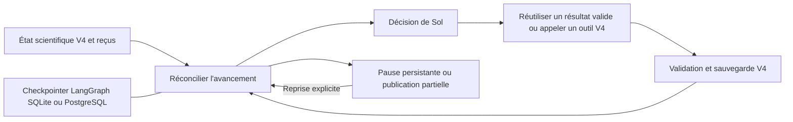

> Démarrage local corrigé : utiliser `scripts/start_ennoscholar_v5.py --profile local-v4 --env-file D:\EnnoSmart\.env --port 8002`. Le lanceur réutilise explicitement la base SQLite et le profil OpenAI local du lanceur V4 ; il ne charge plus la connexion PostgreSQL générale pour cette installation. Ajouter `--check-config` pour vérifier en lecture seule sans serveur. Voir le rapport d’intégration.

> Mise à jour du 27 octobre 2026 : le raccordement Responses/backend/interface est maintenant implémenté dans `agents/EnnoScholarV5`. Voir [le rapport d’intégration](../../docs/ennoscholar-v5-integration.md) et `INTEGRATION_RESULTS.md`. Les sections ci-dessous décrivent le prototype hors ligne précédent ; ses mentions de ports de production non raccordés sont historiques et remplacées par le rapport d’intégration. PostgreSQL réel et qualité scientifique de Sol restent non testés.

# EnnoScholar V5 expérimentale — faisabilité et prototype hors ligne

Audit et expérience du 27 octobre 2026. **V4 demeure la version active.**

Branche : `codex/ennoscholar-v5-langgraph`.
Worktree : `C:\Users\hp\.codex\worktrees\ennoscholar-v5-langgraph\EnnoSmart`.
Les changements V4 déjà présents, y compris `original.py` non suivi par Git, ont été copiés à l'identique dans ce worktree avant l'expérience. Les différences Git du dossier V4 dans cette branche sont cet état initial copié, pas une réécriture expérimentale. Les nouveaux développements sont exclusivement dans `experiments/ennoscholar_v5`.

## Recommandation

Conserver V4 en production et poursuivre une intégration progressive de LangGraph pour l'exécution durable, sous réserve des validations PostgreSQL et du port Sol encore nécessaires. Ne pas remplacer aujourd'hui V4 par ce prototype.

Le bénéfice démontré est la continuité des opérations et des connaissances, pas une amélioration mesurée de la pertinence scientifique de Sol. La projection des tâches manquantes est du code applicatif : elle pourrait aussi améliorer V4 sans LangGraph. LangGraph évite de réécrire une partie des mécanismes de checkpoint et de reprise ; il ne dispense pas des validations scientifiques, du registre budgétaire et des transactions existants.

## Ce que montrent les deux traces réelles

| Cas | État réellement enregistré | Défaut de continuité à traiter |
|---|---|---|
| Chimie, `0f091608d85c4eef9b945ecc22104d46` | 10 demandés, 50 notices, 8 jugements, 5 publications proposées ; 6 tours d'exploration + 2 de finalisation ; 387,984 s ; 0,5849 USD enregistrés | Li dispose d'un texte extrait non lu. Fang et Bisztyga n'ont pas de tentative documentaire. Le suivi des seules analyses lues mais non sauvegardées ne représente pas toutes les lectures non commencées. |
| Stokes, `3d81c866b2364d7fbe8b87f376669f68` | PDF local complet de 29 pages ; pages 1–20 extraites ; `next_page=21` ; 27 preuves présentées, 18 affirmations canoniques avec 13 preuves dans une fiche ciblée ; 214,860 s ; 0,391354 USD enregistrés | Les pages 21–29 restent à extraire/lire. Une fiche sauvegardée ne signifie pas une analyse exhaustive. Des passages de méthodes des pages 18–19 héritent du libellé REFERENCES. |

Ces exports sont les états persistés des sessions au moment de l'audit et les traces des runs ; ce ne sont pas des réponses fournisseurs brutes ni un rejeu du raisonnement de Sol. Les 50 notices chimiques incluent des articles issus d'une mémoire hors sujet : elles ne représentent pas 50 travaux chimiquement pertinents. Les deux fiches chimiques pertinentes proposées sont celles de Chen et Kok 2024.

Autres défauts indépendants de LangGraph : normalisation bibliographique de `CO 2` et `CO<sub>2</sub>`, classification de certains titres de méthodes PDF, accès distants bloqués, interprétation visuelle des figures et validation sémantique de chaque affirmation. Aucun de ces défauts n'est corrigé par l'ajout du graphe.

## Répartition des responsabilités

| Fonction | Réutilisation V4 | Rôle de LangGraph |
|---|---|---|
| Comprendre le sujet, choisir les axes, juger la pertinence et comparer | Sol ; instructions scientifiques `SYSTEM` et `DISCOVERY_GUIDANCE` importées sans changement | Exécuter la décision, sans score ni parcours scientifique imposé |
| Fournisseurs et notices | `sources.py`, `store.py`, `ScholarTools.search`, réservoirs et entrelacement existants | Suivre les opérations et leurs résultats ; conserver les candidats non examinés |
| Mémoire entre conversations | `service.article_memory`, `ScholarTools.reuse_articles`, `evidence.reusable_science` | Recevoir le callback autorisé du service ; aucune nouvelle mémoire bibliographique |
| Documents, PDF, tableaux, pagination | `network.py`, `pdf_store.py`, `tools/fulltext.py`, `tools/extraction.py`, `ScholarTools.execute(get_fulltext)` | Conserver référence documentaire, empreinte, état partiel et `next_page` |
| Lecture et preuves | `evidence.py`, fenêtres de lecture, `ScholarTools.delivered(inputs=...)` | Distinguer preuve proposée, effectivement présentée et utilisée par une analyse sauvegardée |
| Analyses | `ArticleAnalyzer.save`, lecteurs exacts et `get_analysis_claims` | Conserver les tâches de sauvegarde/enrichissement ; ne pas déclarer une fiche exhaustive |
| Publication | `publication.publish`, contrôles bibliographiques et de preuves | Accepter le résultat validé ou garder son refus ; publier partiellement sans invalider les acquisitions |
| Rédaction | `writing_context`, plans, sections, versions et validations actuelles | La rédaction reste dans le pipeline actuel ; les tests vérifient l'accès du dossier de section aux connaissances archivées |
| Coûts et exploitation | `finance.MeteredClient`, `job_ledger.JobMeter`, `TaskResults`, driver/leases de `service.py` | Checkpoint d'avancement et arrêt/reprise ; ne pas créer un second registre financier en production |

Points de code V4 : `original.run` vers la ligne 807 ; bascule après six tours vers 984 ; `model_context` vers 511 ; `toolkit.delivered` vers 841 ; reprise PDF locale vers 1721 ; `service.article_memory` vers 119 ; `evidence.reusable_science` vers 84 ; `finance.MeteredClient` vers 357 ; `TaskResults` vers 86 ; `writing_context.section_dossier` vers 256.

La V4 possède déjà des jobs de recherche/rédaction, un registre d'exécution, des reçus et des réservations persistantes. Les dupliquer serait contre-productif. Le prototype n'appelle pas `original.run()` comme un unique nœud : cela conserverait exactement le problème des six tours.

## Architecture testée



Le modèle choisit l'outil. Le graphe ne force pas une suite recherche → PDF → analyse pour chaque notice. Les tâches de profondeur et les candidats non examinés sont des informations, pas des interdictions de finaliser honnêtement.

Fichiers expérimentaux :

- `progress.py` : projection factuelle des états V4, tâches, pagination, preuves et vue de travail bornée transmise au modèle. Les éléments omis du contexte sont comptés ; ils restent intégralement dans l'état scientifique et les checkpoints.
- `adapter.py` : appel des véritables outils V4 et de leurs validateurs ; mêmes instructions scientifiques, même modèle autorisé ; état des plafonds de recherche, de candidats et d'analyse conservé entre nœuds.
- `graph.py` : exécution durable, budget cumulatif, reprise, préparation et réception des décisions, finalisation V4.
- `policy.py` : clés d'opérations, réutilisation et détection de stagnation ; aucun jugement de pertinence scientifique.
- `checkpoints.py` : savers officiels SQLite et PostgreSQL.
- `repository.py` : **dépôt de test uniquement**, une copie courante des sessions archivées et des reçus transactionnels. En production, cette interface doit utiliser les transactions et reçus V4, pas devenir une deuxième base de connaissances.
- `prepare_cases.py` : exports SQLite en lecture seule et référence locale au PDF Stokes, avec contrôle SHA-256.
- `run_offline.py`, `compare_offline.py`, `tests/` : vérifications sans réseau, secrets, plugins pytest automatiques ou accès en écriture à V4.

Le PDF n'est pas recopié par checkpoint. L'archive Stokes de test est un lien physique vers le fichier existant, ouvert uniquement en lecture ; son empreinte est contrôlée. Textes, extraits et analyses restent dans le dépôt scientifique de test ; les checkpoints contiennent identités, empreintes, curseurs, compteurs et références d'opérations.

## Décisions de continuation et anti-redondance

1. **Aucune limite scientifique fixe de tours.** Le compteur sert à la traçabilité ; `max_tool_rounds=6` de V4 n'est pas un critère d'arrêt dans V5. Sept lectures utiles et leur sauvegarde peuvent donc continuer dans le même job si ses autres ressources le permettent.
2. Plafonds initiaux inchangés du profil de test V4 : 4 USD, 600 secondes actives, 400 000 tokens, 48 appels d'outils. Les limites internes des outils V4 restent en vigueur. Une reprise ne remet jamais ces compteurs à zéro ; le temps passé à attendre la reprise n'est pas facturé comme du temps d'exécution.
3. Sol dispose de la demande V4, des données scientifiques sélectionnées par `model_context`, du dernier résultat d'outil et d'une vue bornée des travaux restants. Une opération doit se rattacher au travail restant ou à un objectif scientifique explicite ; il n'y a pas de LLM contrôleur supplémentaire.
4. Les recherches déjà collectées réutilisent **le cache V4 existant**. Le graphe réutilise aussi les reçus d'opérations identiques réussies. Les clés tiennent compte des arguments, de l'identité documentaire, de la version, de la représentation, des sources de preuves pertinentes et de l'objectif déclaré.
5. Un PDF déjà conservé n'est pas téléchargé à nouveau. Un intervalle déjà extrait n'est pas réextrait ; `next_page` permet d'extraire uniquement les pages manquantes. Une autre représentation explicitement motivée reste autorisée.
6. Une lecture identique peut être retransmise depuis son reçu, sans refaire son extraction. Une nouvelle question scientifique, `revisit`, une autre fenêtre ou une version différente ne sont pas assimilées automatiquement à un doublon. « Historiquement présenté » reste distinct de « présent dans l'entrée actuelle ».
7. Une analyse identique et validée peut être réutilisée ; enrichir une fiche partielle reste possible. Le graphe ne fabrique pas de résultats et ne transforme jamais un abstract en texte intégral.
8. Un échec connu n'est pas considéré comme un succès. Une relance exige une nouvelle piste/version ou une raison explicite ; les règles V4 `retry_at`, les statuts HTTP, délais et limites de tentatives restent appliqués par le récupérateur.
9. Deux opérations consécutives, pour le même objectif déclaré, sans changement des candidats, jugements, pages, preuves ou fiches déclenchent une **pause de sécurité pour stagnation**. Ce seuil n'est ni une limite générale de deux tours ni une preuve que la littérature est épuisée. Les objectifs réellement différents restent possibles. C'est un compromis conservateur, à calibrer sur des traces supplémentaires.
10. Sol peut finaliser une réponse honnête et partielle ; des candidats non examinés ne doivent pas tous être analysés pour pouvoir répondre. L'absence de progression ou l'épuisement d'un budget conserve les acquisitions et les tâches. Un job financièrement épuisé ne peut pas être réalimenté par un simple `resume` : une future reprise financée exige une nouvelle autorisation de budget, sans refaire les acquisitions.

Le système ne peut pas prouver déterministement que deux formulations ont la même signification, ni qu'une mémoire est pertinente pour un domaine. Il réutilise les identités vérifiées et les critères existants ; l'appréciation scientifique et les objectifs de recherche restent ceux de Sol. Aucun filtrage lexical nouveau ne prétend résoudre cette question.

## Interruptions et cohérence transactionnelle

Les décisions et les effets validés sont reçus dans un registre d'opérations avec le même commit que l'état scientifique de test, avant le checkpoint du graphe. Un arrêt après ce commit reprend le reçu, pas l'appel de modèle ou l'outil déjà terminé.

Un appel fournisseur commencé dont la réponse n'a pas été reçue reste **incertain**. Il n'est pas réessayé automatiquement : LangGraph ne garantit pas un « exactement une fois » pour les effets externes. Une erreur d'assemblage de contexte avant l'API ne doit pas être classée comme une dépense incertaine. Le prototype teste les deux cas.

La reprise vise le dernier état. Le rejeu arbitraire d'un ancien checkpoint contre une science plus récente est refusé. Il ne s'agit pas d'un historique complet versionné des sessions. L'intégration multitravailleur devra réutiliser les leases et autorisations du service V4 ; un simple `thread_id` n'est pas un mécanisme d'authentification.

## Résultats et limites de validation

Voir `TEST_RESULTS.md`, `.artifacts/tests.xml`, `.artifacts/comparison.json` et `.artifacts/process-restart.json`.

Les tests exploitent les textes et preuves réels archivés, mais **les décisions de Sol sont simulées**. Les fiches ajoutées dans la comparaison sont des fixtures de transport d'un passage exact, pas une démonstration de la qualité analytique d'un LLM. Les analyses réelles de V4 restent intactes. Aucun nouvel article n'a été découvert sur le réseau et aucun test scientifique payant n'a eu lieu.

En chimie, le prototype ne prétend pas avoir trouvé les cinq articles encore manquants. Il rend ces besoins persistants, lit Li localement, valide la sauvegarde d'une fiche ciblée et transmet ses preuves au dossier de rédaction. Fang et Bisztyga restent à récupérer.

Pour Stokes, les pages 21–29 sont réellement extraites du PDF local de test ; les anciennes preuves et la fiche initiale restent préservées. L'extraction peut devenir complète alors que la lecture et l'analyse restent ciblées et incomplètes. Les libellés PDF fautifs et l'interprétation des figures ne sont pas corrigés.

Les tests vérifient également : requêtes distinctes sans nouveaux résultats, résultats fournisseurs inattendus conservés sans sélection automatique, refus du consultant, rejet de preuves inconnues et de bibliographie invalide, reprise entre deux processus, refus de remise à zéro des budgets et absence de textes volumineux dans les checkpoints.

Le parcours de récupération V4 est aussi testé avec transport HTTP simulé : plusieurs représentations en 404 restent archivées comme échecs sans nouvelle tentative identique ; un 429 suivi d'une représentation XML identifiée permet de conserver le document sans le déclarer analysé. Aucun serveur scientifique n'est contacté.

L'égalité du nombre d'appels ne garantit pas l'égalité du coût : la vue de travail V5 ajoute jusqu'à 5 000 caractères par décision. Les tailles d'entrée sont mesurées séparément ; les tokens, le cache fournisseur et les coûts réels avec Sol restent à mesurer. La comparaison directe utilise les outils V4 sous décisions imposées, pas le streaming complet de `original.run` avec ses propres instructions de progression.

## PostgreSQL et port Sol : ce qui reste à valider

L'implémentation utilise le saver officiel `langgraph-checkpoint-postgres`, avec schéma expérimental dédié, DSN explicitement fourni et création des tables uniquement sur demande `setup=True`. Aucun schéma V4 n'est migré. Les tests locaux utilisent le saver officiel SQLite.

**Aucune connexion à un vrai PostgreSQL n'a été testée.** Restent à vérifier sur une base jetable : installation des tables, droits, reprise après arrêt de processus, concurrence, transactions applicatives/checkpoints, sauvegarde, nettoyage et taille des historiques. La compatibilité de conception et l'import du saver ne remplacent pas ce test.

**Le port de production vers Responses/streaming, `MeteredClient`, la recherche Web native et le service authentifié n'est pas raccordé.** Le runner refuse les clients non explicitement hors ligne. Les instructions scientifiques sont réutilisées, mais les appels de modèle des tests sont simulés. L'interface V4, ses plans et la rédaction actuelle ne sont pas remplacés. La réservation financière de production devra rester celle de V4 : les réservations synthétiques des fixtures ne sont pas une garantie de facturation en production.

Versions de test : LangGraph 1.2.11, checkpoint 4.3.1, saver SQLite 3.1.2, saver PostgreSQL 3.1.2. Les dépendances supplémentaires sont dans `.deps` de cette expérience ; l'environnement Python actif V4 n'a pas été mis à jour. Une erreur de contrainte de dépendance a été résolue dans ce dossier isolé, sans mise à jour de V4.

## V4 améliorée ou intégration LangGraph ?

| Critère | Améliorer uniquement V4 | Intégration progressive proposée |
|---|---|---|
| Suivi des besoins oubliés | Ajouter la même projection aux mécanismes existants suffit pour beaucoup de défauts constatés | Nécessite également cette projection : LangGraph ne la déduit pas |
| Reprise exacte des opérations | Étendre les reçus et le driver déjà présents ; moins de dépendances | Checkpoints, interruptions et reprise de nœuds fournis par la bibliothèque ; reçus applicatifs toujours nécessaires |
| Autonomie scientifique | Conservée | Conservée si le graphe orchestre les décisions plutôt qu'un parcours scientifique fixe |
| Coût LLM | Aucun appel obligatoire supplémentaire nécessaire | Aucun appel obligatoire supplémentaire nécessaire ; gains réels encore à mesurer avec Sol |
| Latence locale et stockage | Moins d'écritures de checkpoints | Surcoût mesuré sur ce prototype ; politique de durabilité et rétention à dimensionner |
| Risque de migration | Plus faible à court terme | Adaptation des transactions, du streaming, des budgets et des autorisations nécessaire |
| Défauts PDF/bibliographiques | Corrections spécifiques toujours nécessaires | Identique : le graphe ne corrige ni les figures ni l'identité bibliographique |

Adoption conseillée par étapes : conserver V4 active ; valider les checkpoints PostgreSQL sur base jetable ; raccorder les ports existants sans changer la science ; effectuer ensuite un comparatif contrôlé avec Sol et budget explicitement autorisé. Une simple amélioration V4 reste raisonnable si l'on préfère limiter les dépendances et que la reprise par jobs suffit. Le choix de LangGraph se justifie surtout par les interruptions longues, la visibilité des tâches et la reprise fine, pas par une promesse automatique de meilleurs articles.

Documentation officielle consultée : [persistance](https://docs.langchain.com/oss/python/langgraph/persistence), [checkpointers et durabilité](https://docs.langchain.com/oss/python/langgraph/checkpointers), [interruptions et reprise](https://docs.langchain.com/oss/python/langgraph/interrupts).

## Reproduction sans API

Depuis le worktree V5, avec le Python existant, sans démarrer d'application :

```powershell
& 'D:\EnnoSmart\.venv\Scripts\python.exe' -B experiments\ennoscholar_v5\run_offline.py
& 'D:\EnnoSmart\.venv\Scripts\python.exe' -B -m experiments.ennoscholar_v5.compare_offline
```

Les exports privés et les dépendances ne sont pas suivis par Git. `prepare_cases.py` permet de reconstituer les fixtures depuis la base V4 en lecture seule. Les phases `--phase start` puis `--phase resume` de `compare_offline` démontrent une reprise entre processus ; `start` refuse d'écraser une expérience existante. Rien n'a été déployé, commité ou poussé.
